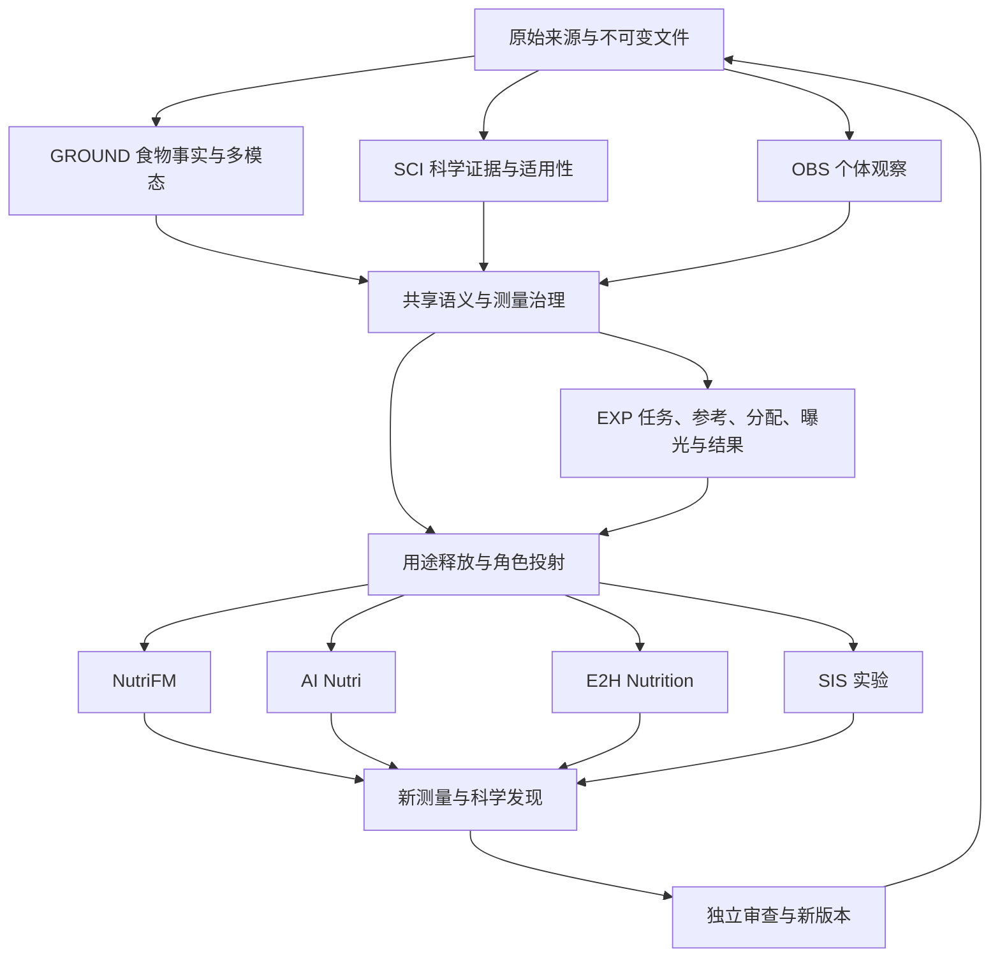
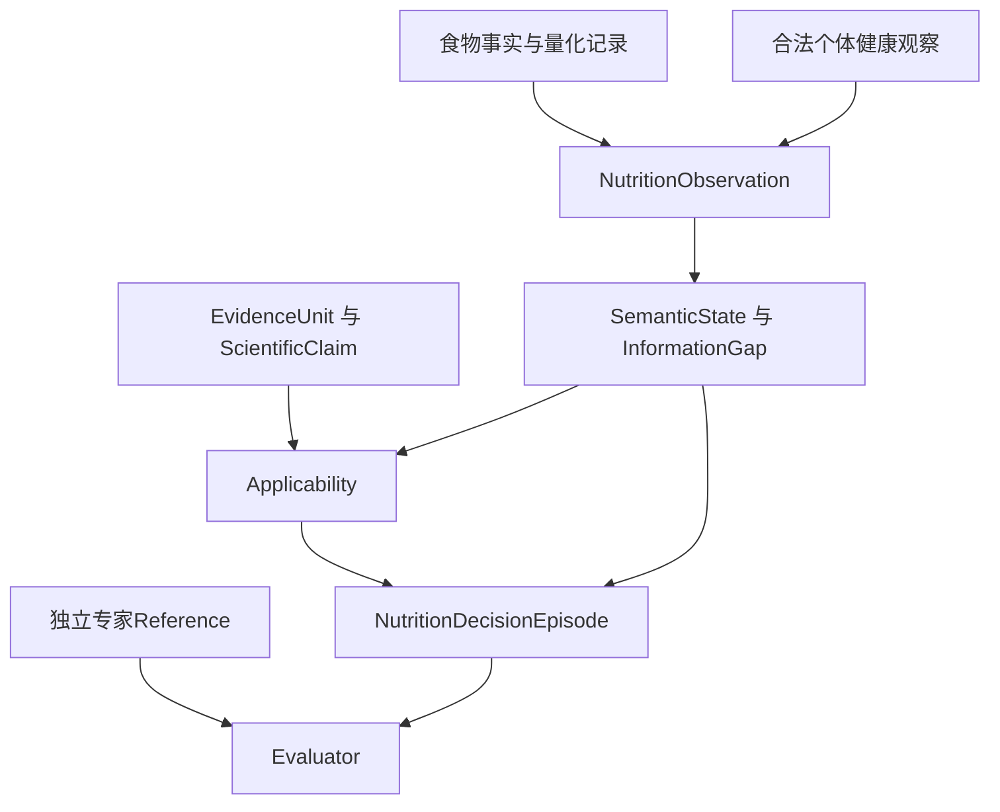
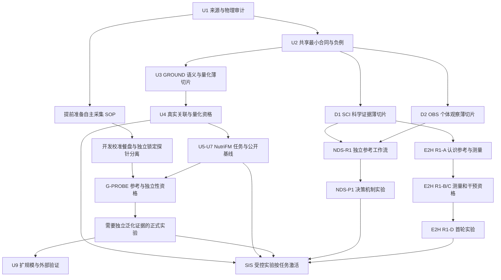

# AI Nutri Unified Data Foundation v2.1

## 第一性原理驱动的统一营养科学数据基础建设方案

**目标：建立同时支持营养多模态模型、营养决策智能、营养科学传播及 SIS 受控科学实验的统一数据基础。**

本文为 v2.0 全量修订版（执行收敛），不是独立补丁或摘要。保留11个 Part、47章、四世界、十资产域、四研究方向和历史资产，修复外部审查指出的实验闭合和实际工程问题；不新增科学本体或研究纲领。用户已要求合理意见直接纳入新版，但正式物理合同、真实数据资格、实验与发布门仍须获得相应证据。无实际 CSV/媒体审计、训练或人体实验结果在本轮产生。具体采纳理由及变更检查见附录 D。

## 阅读导航

- [[#Part I｜第一性原理与科学边界]]
- [[#Part II｜目标反推的数据需求]]
- [[#Part III｜统一科学数据架构]]
- [[#Part IV｜已有资产及补建策略]]
- [[#Part V｜跨数据集语义与事实对齐]]
- [[#Part VI｜营养测量与可计算知识]]
- [[#Part VII｜四条科学研究链的实施合同]]
- [[#Part VIII｜数据生产、资格与隔离]]
- [[#Part IX｜工程实现及接口]]
- [[#Part X｜总体执行计划与验收]]
- [[#Part XI｜科学价值、风险与决策]]
- [[#附录 A｜22 个原有数据集逐项接入档案]]
- [[#附录 B｜NutriData 子资产接入清单]]
- [[#附录 C｜权威文件、来源及版本迁移]]
- [[#附录 D｜外部审查处置、非回归与执行验收记录]]

## 执行摘要

第一性问题不是“怎样整合所有食物数据”，而是：**在食物和人体状态不能被完全观察、科学证据带有适用条件、人类认识不能直接测量、智能系统由可替换组件组成的前提下，如何形成可靠的表示、测量、干预和因果评价？**

由此导出四个数据世界（GROUND、SCI、OBS、EXP）、一个共同治理内核、四种专门的科学任务视图。四世界保持语义和权威独立；共同内核统一身份、来源、测量、关联、信息边界和用途。数据湖、知识图谱、模型和 Agent 都是可替换实现，不是研究目标。

当前资源：原登记 NDF-G001–G022 共22个数据集（用户报告下载完成）；NutriData 全部 CSV（用户报告拥有，内部文件数量与版本待核）。建议保留 NDF-G001–G022，新增候选集合 ID NDF-G023，内部表待实际扫描后登记。23 是当前登记口径下的顶层来源集合数，并非全部项目数据集或独立样本数。已有 P0 注册/扫描工具、NDF-ALIGN v0.1、NutriFoundation 专家工作台资产均应复用；本轮未读取真实大数据或 NutriData CSV、未验证现有部署。

**建设优先级：先实际画像、再冻结物理合同；先完成食物成分与菜肴的核心薄切片，同时独立推进 SCI/OBS/NDS/E2H。物理量化按任务执行 ID/尺度止损规则。需要独立泛化或污染敏感结论的模型及 SIS 实验，必须先通过独立探针与参考资格门，而非等到 U9 才采集。**

v2.1 新增的是实施约束，而不是上位理论：

- B0 实地画像先于 B1 物理定型；B2 NutriData 只转换 2 个核心逻辑子库，第三个 GI 子库按任务有条件启用。
- B3 把隐性油盐与出品率变成有依据、可校准、可拒答的参数；明确质量参考、共享成分计算参考、独立计算参考、直接化学测量的不同评价对象。
- B0-P 提前准备独立采集；G-PROBE（U6 的前置支线）完成开发/校准与锁定探针分离。公开集基线和条件性探索允许先做，独立泛化强主张不允许跳过门。
- 采用 PI + Coding Agent + 独立上下文 Critic 的轻量执行方式；关键营养语义、Gold 与人体实验继续按上游要求独立专业审查。
- 物理合同补齐 instance_class，科学侧独立类型表/约束，去重从可复测小样进入批处理、近邻召回及泄漏分组。

---

# Part I｜第一性原理与科学边界

## 1. 从目标而非现有数据推导

| 研究对象 | 潜在对象或能力 | 可观察数据 | 最小可辩护的结果 |
|---|---|---|---|
| NutriFM | 食物实例及其属性；模型感知、推理能力 | 图像、文本、几何、称重、成分、原生标注 | 特定输入条件下的独立任务有效性 |
| AI Nutri | 个体营养状态及合理行动空间 | 膳食报告、人体测量、检验、证据及专家判断 | 当时信息条件下参考相对决策质量 |
| E2H-Nutrition | 人类认识状态及其变化 | 任务、干预序列、曝光、回答、迁移、校准 | 有效测量下的认识干预效应 |
| SIS | 复合智能系统能力、状态、控制及动态 | 组件配置、输入、处理与事件、成本、评价 | 在控制条件及边界下的机制或策略效应 |

必须先定义目标任务、允许输入、参考、测量、风险和估计量，再决定采用哪些数据。已有数据不支持的科学问题可以保持开放，不得通过推断制造真值。

## 2. 第一性约束

1. 部分可观察性：图像只是食物的投影；报告摄入和生理状态也只被部分观测；模型对潜在对象的估计必须保留不确定性。
2. 科学证据的条件性：群体研究有设计、剂量、人群、时间、结果及证据确定性；科学上允许的推荐并非个体的必然选择。
3. 人类与系统能力需要独立测量：模型输出、专家判断、评价参考、真实状态不是同一事物；认识改变不能由一次答对推定，系统机制不能由系统总分提高推定。
4. 因果效应需要操纵、对照及独立评价：数据源大小、相关性、排序分数和观察性结果不能自动升级为因果结论。
5. 历史及风险约束：不同角色能看到的信息有时点和权限边界；未来结果不能回流到当时决策；安全和授权是硬门而非可被平均成绩抵消的代价。

## 3. 必须始终分离的科学对象

| 不等价关系 | 对数据设计的直接要求 |
|---|---|
| FoodConcept ≠ FoodInstance ≠ Recipe ≠ ProductVersion | 实体类型、粒度与版本独立 |
| Food Served ≠ Food Consumed | 餐前、餐后、摄入报告及真实测量分别记录 |
| NutrientValue ≠ ScientificClaim ≠ Recommendation | 成分事实、研究主张、建议保持独立 |
| Observation ≠ State；Dietary Recall ≠ Habitual Diet | 保留观测窗口、推断方法和误差 |
| ExpertJudgment ≠ Reference ≠ LatentTruth | 专家原始判断、构造、仲裁、资格分开 |
| Decision ≠ Execution ≠ Outcome | 建议、授权、实施、依从性及后续结果分开 |
| Intervention ≠ Cognitive Mechanism ≠ Presentation | E2H 不把可操纵算子称为已证实内部机制 |
| Delivered ≠ Received ≠ Enacted；Outcome ≠ Latent State | 日志、接触代理、操作和认知测量分开 |
| Model Capability ≠ System Capability；Performance ≠ Causality | 独立组件基线、实验控制与科学路由 |
| Not Annotated ≠ Absent ≠ Unknown；Missing ≠ Zero | 保留缺失语义，使用任务掩码 |

## 4. 权威、范围与研究边界

SIS R5 管理一般科学语义、SCF/SDR/ASR、CSCI/X2、因果和测量治理；NDSF v0.1 管理营养领域身份、状态、行动、参考和安全；临床营养另外受 SIS-MED R6 P0.4 约束；NDF-D0–D2 与 NDS-R1 管理数据构造和参考实验；E2H T0.4 / R1 BP 管理认识任务、干预、测量与实验。UDF 负责实现这些规范所需的共享数据基础及发布接口，不能反向改变上游语义。SIS R5 Part VII-A 的能力定位补丁仍按 proposed 状态处理，内部化与外部化可作受控实验解释，不能冒称已采纳的新核心本体。

一般健康营养和临床、特殊人群、高风险任务分别定义 profile。临床营养数据可表达，不等于有临床部署资格。人体实验及真实临床数据需单独的伦理、知情同意、数据使用授权、安全治理与相关专业人员审查；不因公开数据存在而自动许可。第一阶段不以临床疗效、长期行为改变或大规模产品作为通过条件。

---

# Part II｜目标反推的数据需求

## 5. 数据需求矩阵：必要与非必要

D 表示直接必要（对声明的任务）；C 表示条件性需要或可作增量实验；— 表示不构成该研究阶段的前置。不是源数据质量评分。

| 数据能力 | 多模态模型 | 营养决策文本基线 | E2H R1 | SIS 机制实验 |
|---|---|---|---|---|
| 食物实体、食品状态、成分与单位 | D | D（按任务） | C | D（食物任务） |
| 图像、区域、动作、真实实例关联 | D（对应任务） | C | C（素材） | C（多模态机制） |
| 真实称重与营养计算参考 | D（量化） | C | C | D（量化机制） |
| 科学主张、证据不确定性、适用性 | C | D | D | D（证据/决策任务） |
| 个体膳食及健康观察 | C（摄入任务） | D | —（R1一般科学学习） | C（决策任务） |
| 独立专家参考 | D（任务有效参考，不均需临床专家） | D | D（认识参考） | D（目标评价） |
| 人类干预、曝光、回答及随访 | — | C（另立人机试验） | D | C（若研究对象包含人类） |
| 组件、实验分配、运行日志及预算 | D（训练实验） | D | D（干预实现） | D |
| 长期真实个体行为/临床轨迹 | —（基础任务） | C（动态扩展） | —（R1不研究健康结局） | C（SDR/ASR任务） |

因此不会存在一份同时具有全部字段的通用样本表。应通过独立原生记录形成不同的任务包，缺失的必要对象阻断对应任务，不阻断其他研究方向。

## 6. 四类科学任务的最小数据单元

| 任务视图 | 最小科学/评价单位 | 输入 | Reference 或 outcome | 关键独立性 |
|---|---|---|---|---|
| GroundingTaskBundle | 物理实例、图像区域或餐盘；按任务确定 | 媒体与允许上下文 | 类别、食材标注、称重或成分计算参考 | 同一餐盘/实物/原图及衍生不跨划分 |
| NutritionDecisionEpisode | 明确决策时点 | 当时合法观察、目标、可访问证据 | 条件化可接受行动集合及不确定性 | 专家参考、遮蔽值及未来结果不进入输入 |
| EpistemicInterventionEpisode | participant × CaseFamily × intervention realization | 同一科学主张集、任务及干预 | 合格认识参考；实际人类响应 | 参与者随机化、题目家族与版本隔离 |
| SystemExperimentRun | 系统 × TaskBundle × condition × repeat | 明确信息/资源/系统边界 | 独立 evaluator、结果、轨迹和成本 | 对照共享可比输入；实验分配与输出不可改写 |

这些视图复用 NDSF/NDF/E2H 已有对象身份。GroundingTaskBundle 和 SystemExperimentRun 是建议的工程组合名，不新增领域本体。任务单元不等于统计独立单位；分析必须处理参与者、餐盘、菜谱、来源、case 与 repeated run 的相关性。

## 7. 最小科学基础判定

每一项研究要能回答：

- 具体测量什么、在什么条件下、谁是参考权威？
- 是否存在支持该测量的真实来源、关系及可恢复版本？
- 是否可以将合法输入与独立参考分离？
- 科学解释是否能区分信息变化、系统机制变化、训练变化与预算差异？
- 缺失数据是否会改变结论？能否被拒识、补问或明确为局限？

若不能回答，不允许以大规模数据处理或模型训练代替。可先建立一个薄切片的最低能力，待证明语义和测量有效再扩张。

---

# Part III｜统一科学数据架构

## 8. 四个世界、共享内核和四类数据视图



图为数据依赖与治理示意，不代表营养或系统因果关系。EXP 中参考、隐藏测量和结果不能因为连到 P 而变成模型可见信息；P 必须执行角色白名单。学习、测量和验证的独立性针对特定实验而非全部来源永久隔离。

## 9. 四世界的资产域及身份

| 世界 | 资产域（沿用 v1.0） | 核心对象 |
|---|---|---|
| GROUND | A01 Food Entity | FoodConcept、Ingredient role、DishConcept、Recipe、ProductVersion、FoodInstance、Alias |
| GROUND | A02 Multimodal Media | MediaAsset、MediaGroup、ObservationUnit、Annotation、AnnotationProtocol |
| GROUND | A03 Recipe & Process | IngredientSpecification、ProcessStep、FoodStateTransition、yield |
| GROUND | A04 Composition & Portion | ComponentConcept、MeasurementDefinition、CompositionRecord、NutrientValue、PortionObservation |
| SCI | A05 Scientific Evidence | SourceArtifact、StudyIdentity、EvidenceUnit、EvidenceSynthesis、ScientificClaim、ScientificRelation、Conflict、Gap、Verification |
| SCI | A06 Guideline & Applicability | Recommendation、适用条件、证据状态、风险与知识快照；个体适用性判断是决策派生关系 |
| OBS | A07 Individual Observation | NutritionObservation、Context、SemanticState、InformationGap、InformationBoundary、Monitoring/Transition（有合法数据才实例化） |
| EXP | A08 Decision & Expert Reference | DecisionEpisode、ExpertJudgment、ReferenceConstructionRecord、Adjudication、Qualification、Evaluator |
| EXP | A09 Epistemic Intervention | ScientificReferenceState、EpistemicTask、Demand、AcceptableRegion、CaseFamily、TreatmentManifest、Exposure、Outcome |
| EXP | A10 System Experiment | ExperimentContract、ComponentProfile、Assignment、RunManifest、Event、Measurement、Evaluation、ResourceUse |

归属用于数据组织，不创造新的科学 primitive。E2H ScientificReferenceState 与 NDF ScientificReferenceState 的共用证据和版本可连接，但任务投影、规范目标和语义边界需明确；不强制将它们认作同一对象。临床相关对象遵循上游合同。

## 10. 共享内核只包含可复用的治理与语义

| 合同 | 最小职责 |
|---|---|
| Identity & Revision | 稳定对象ID、版本、原生ID、修订链与生命周期 |
| Source & Lineage | 来源版本、精确锚点、派生规则、输入依赖、生成方法 |
| Typed Relation | 端点及粒度、关系、方向、条件、来源、审查 |
| Measurement | 概念、单位、基准、方法、对象、窗口、误差与效度 |
| Uncertainty & Missingness | 数据来源方式、未知、未表达、冲突、不适用、掩蔽等正交轴 |
| Information Boundary | 谁在什么时点合法访问哪些数据；系统视图与评价视图分离 |
| Purpose & Qualification | 训练、运行知识、参考、校准、评测等用途及各自通过条件 |
| Rights & Security | 来源许可、用途约束、同意、访问权限、保留/删除政策 |
| Dependency Group | 同源或统计依赖、训练评测泄漏及实验相关性 |

统一的是合同，不是把所有对象写在同一行。标注来源和质量状态不得合并为一个置信分。数据的科学权威取决于来源及特定任务资格，不因进入中心数据湖而改变。

## 11. 最小对象关联模型

食物概念、食品状态、配方版本及产品版本作为语义中心；各数据源通过原生记录连接统一概念，真实实例连接另走事实通道，营养量通过测量通道连接。个人标识采用来源域隔离的假名ID，不根据食物、日期、图片或健康特征跨数据库重识别个体。

```yaml
CommonEnvelope:
  object_id: stable_internal_id
  revision_id: immutable_revision
  kind: typed_object
  schema_version: declared_contract
  lifecycle: DRAFT # or FROZEN / SUPERSEDED / WITHDRAWN
  producer_role: declared_role
  created_time: declared_clock
  provenance_refs: []
  dependency_refs: []
  source_class: declared_source_type
  instance_class: REAL_SOURCE_GROUNDED # or MIXED_CONSTRUCTED / SYNTHETIC / SIMULATED
  purpose_release_ref: declared_release_or_pending
  supersedes_ref: declared_previous_revision_or_NA
```

继承 NDF-D0；以上为字段示意，非可直接用于生产的真实实例。关键未知字段使用上游 Slot<T>（VALUE、UNAVAILABLE、NOT_APPLICABLE、PENDING）及理由，不用裸 null 表示未知。模型推断应保存模型、提示、输入、输出、版本和不确定性。源记录与派生数据均保持可回溯，撤回/更正创建新版本并传播影响，不静默改历史结果。

### v2.1｜实例身份与来源语义强制分离

上游 NDSF Part III §2.2 CommonEnvelope 明确要求 `instance_class`，NDF-D0 §6 则规定 `source_class` 与用途引用等字段；本实现必须同时保留，不能选择其中之一。`source_class` 记录来源种类（原始资料、原始数据、专家意见或模拟来源等，以具体对象合同为准），`instance_class` 记录整个实例的构造身份：

| instance_class | 含义及用途 |
|---|---|
| REAL_SOURCE_GROUNDED | 全部构成性事实可追溯真实来源；不意味着无误差、独立或已资格化 |
| MIXED_CONSTRUCTED | 真实来源与显式构造/扰动组合；原生事实与构造字段分层 |
| SYNTHETIC | 人工或程序生成的合成实例，用于回归、开发或明示的合成实验 |
| SIMULATED | 有明示模拟器、环境及版本的事件/状态；不冒充真实观察或真实轨迹 |

字段级仍保留 NDSF 的 `origin_mode`、`knowledge_state`、`construction_class`、`visibility_overlay`，独立于实例身份；一个真实来源的自报记录仍可能有测量误差。合成/模拟/混合样本在 release 中按用途显式分层，纯真实观察评测默认拒绝非 REAL_SOURCE_GROUNDED；合法的混合构造 NDS benchmark 和显式模拟 SIS 实验不因此被禁止，但必须按自己的合同发布和报告。历史缺失该字段的记录先标迁移待定，不默认 REAL，不修改旧冻结记录。schema、外键及 release validator 必须执行允许的实例类别约束；负例见 §35。

---

# Part IV｜已有资产及补建策略

## 12. 先资产登记，再判断研究用途

当前两大自报已拥有来源：22个原始数据集与 NutriData 全部 CSV。它们的优势互补：视觉/媒体、菜谱及过程提供观测与结构先验；NutriData 提供本土食品、参考配方、成分及多种专业属性。都不能替代独立科学证据、个体健康观察和人体实验。

| 能力簇 | 当前候选资源 | 可直接支持的任务（待资格化） | 不能直接支持 |
|---|---|---|---|
| 大规模视觉 | Food2K、ISIA、Food-101、Food-101N、FoodX-251、Food-11、Food-5K、Fruits-360 | 分类、噪声、拒识、层级/跨文化泛化 | 逐图真实配方和营养量 |
| 空间与组成 | UEC100/256、UNIMIB、VIREO | 检测、分割、可见食材 | 隐藏食材或克重 |
| 菜谱与动作 | XiaChuFang、RecipeNLG、RecipeQA、EPIC-KITCHENS | 配方知识、过程推理 | 某张同名图片的真实配方 |
| 成分及标签 | NutriData、Open Food Facts、Menu-Match | 参考营养值、标签、菜单上下文 | 个体摄入量、健康效应 |
| 物理与个体观察 | N5k360、SNAPMe、eButton | 多视角、几何、报告关联、出现事件 | 未证实尺度下的克重、食物出现即摄入 |
| 文化与问答 | FoodieQA、RecipeQA | 文化/过程问答、材料及基准 | 科学证据或人类干预效果 |

全部22项保持原登记ID及原生版本，附录A给出逐项适配、用途和风险。数量不作为资产质量或覆盖目标；复用此前 P0 的原始核查及待验证标记。先读取元数据，不先解压或复制所有图像和视频。

## 13. NutriData 的科学定位与优先级

NutriData 为 NDF-G023 候选来源集合。官网公开介绍显示食物成分库汇集中国2018–2019版及 USDA、澳大利亚、日本等来源；菜肴库有中国菜系的配料、重量、操作及营养信息；并有 GI、氨基酸、补充剂、特医食品等数据。具体 CSV 内容、行数、版本、字段、文件间键及授权尚未读取。不得将一个聚合平台当作单一原始测量机构。

| 子资产方向 | 首期接入目的 | 资格条件 |
|---|---|---|
| 食物成分 | 中文食材、食品状态及成分记录 | 复原食品ID、原始来源、单位、基准、版本、方法 |
| 菜肴 | 中文菜名、参考配方与营养计算 | 恢复食材行、数量、配方ID、份数/产量及数值依据 |
| 氨基酸、脂肪酸等 | 首期仅登记；后续扩展成分概念与精细测量 | 识别化合物、异构体、计量基准及缺失编码 |
| GI及功能成分 | 特定属性与来源测量 | 区分GI、化学成分与效果主张；保留测试条件与研究来源 |
| 补充剂、特医、保健及其他产品 | 产品信息及监管语义 | 市场、版本、批准记录、说明书、风险、可访问权限；不当作疗效证据 |

**首期范围硬约束：** B0 只读登记所有 CSV，但 B2 只选择食物成分库、菜肴库两个逻辑子库（可能由多张实际文件/关联表实现），并选择其中能恢复定义的能量、蛋白质、脂肪、碳水及必要的钠等基础属性。第三个 GI 逻辑子库仅在具体已锁定研究题需要且核心链路通过时启用，GI 不作为基础宏量营养计算的前置；氨基酸、脂肪酸、功能成分、特医等只登记及隔离，待各自任务触发。若核心表缺乏必需键、单位或来源，先切换到已核验的 FDC/对应成分记录或有限的明确源配方，不因补齐全部子库而阻塞整个项目。附录B列出此前讨论的25类候选目录，须用实际 CSV 完整清单复核，而非预设25张表。对 NutriData 中转载的 USDA、同源成分表与衍生菜谱计算，建立原始来源家族，不能将平台中的不同文件视为多份独立证据。

## 14. 需要补齐的最小数据能力

| 缺口 | 优先来源/工作 | 原因与触发条件 |
|---|---|---|
| 统一食物与营养概念 | FoodOn、FDC nutrient IDs、内部中文词表 | 外部语义锚点；不能强制全部概念匹配 |
| 国际成分及摄入编码 | USDA FoodData Central、对应周期 FNDDS | 作为国际参考并支持 NHANES/ASA24；与 NutriData 同源记录去重治理 |
| 真实质量量化 | 原版 Nutrition5k 元数据与 N5k360 crosswalk；自主称重备选 | ID、质量、尺度分门核查；失败按 §18 止损切换；不等待全量媒体 |
| 个体营养及健康观察 | NHANES 2021–2023，按 NDF-D2 选择变量 | 原生调查编码与健康观测；横断面不能伪造成轨迹 |
| 科学证据与推荐 | 现有31个 EvidenceQuestion 的薄切片、论文、指南、研究注册 | 按案例/任务所需检索、抽取、验证与审查；不追求文献总量 |
| 独立真实中国膳食参考 | 提前启动 CN-NutriGround 小型采集；按任务核查 DFood-TJ 等公开数据 | 开发/校准与锁定探针独立；公开数据不自动视为无污染；U9扩规模而非首次采集 |
| 决策专家参考 | NutriFoundation Workbench + NDS-R1 | 人机参考工作流比较，建立可接受行动集合 |
| 人类认识数据 | E2H R1-A/B/C/D | 需要真实参与者及冻结干预；公开问答不是人类结果 |
| 系统科学数据 | 受控模型/系统实验日志和冻结评价 | 自行产生，公开数据不能替代实验分配 |

其他候选如 Recipe1M+、FoodSeg103、MetaFood3D、NutritionVerse 可按缺口补充；不能默认此前未下载，也不能仅为追求规模而收集。先检查已有文件和许可。FDC 五种数据类型的源/测量方式不同，选择记录时保留区分。NHANES 使用指定调查周期、文档及变量定义；人口估计遵循复杂抽样设计，而 benchmark case 抽样不等于代表性总体推断。

---

# Part V｜跨数据集语义与事实对齐

## 15. 对齐不是强制统一真值

22个数据集两两全量映射不可扩展，也无法证明真实实例关联。采用 hub-and-spoke：每个来源通过版本化适配器连接中心概念词表及测量定义；只在原生键或可信证据支持下连接实例。语义相同的菜名不会让图片拥有另一个菜谱的配方、称重或成分真值。

四个独立通道（对 NDF-ALIGN 的兼容细化）：

| 通道 | 处理对象 | 输出 | 允许的强度 |
|---|---|---|---|
| ALIGN-S | 食物、菜品、食材角色、产品、加工状态 | 类型化概念关系 | 概念匹配或候选 |
| ALIGN-F | 原生关联键、同一物理实例、同源图片、餐次记录 | 实例/记录连接 | 只有可证实身份才确证 |
| ALIGN-M | 重量、体积、尺度、份量、时间及摄入窗口 | 可比测量及转换 | 有必要参数及误差才转换 |
| ALIGN-N | 营养素、活性成分、GI、成分计算、产品属性 | 属性概念及测量定义 | 不将不同定义混成同一数值 |

另有科学语义与任务投射，沿用 NDF、NDSF、E2H/SIS，不以食物名称自动连接科学因果主张。ALIGN-N 是测量通道的实现细分，不是新科学本体。

## 16. 统一语义中心与关系类型

保留内部稳定ID（不使用名称作主键）。FoodOn 为外部食品/过程概念锚点；FDC/FNDDS、NutriData、中国食物成分表的源编码用于特定记录连接；Open Food Facts 条码保存字符串、市场与产品快照。地方菜、商品及无法精确映射的概念可建立本地扩展；保留原文、地区、菜系、品种、生熟、可食部、加工与配方差异。Ingredient 是食物在配方中的角色，不必创建第二个物质实体。

采用显式方向 `source_relation_to_target`。例如蛋炒饭→炒饭标为 `BROADER_TARGET`，表示目标更宽；炒饭→蛋炒饭为 `NARROWER_TARGET`。旧表迁移须明确方向，不静默翻转。EXACT 只表示同一粒度概念；CLOSE、RELATED、CONDITIONAL、AMBIGUOUS、UNRESOLVED 不自动进入等价类。商品版本、菜谱变体、实例关系使用独立边 `INSTANCE_OF`、`RECIPE_VARIANT_OF`、`PRODUCT_OF_TYPE`、`RECIPE_PRIOR_FOR`、`HAS_VISIBLE_INGREDIENT_LABEL`、`NATIVE_RECORD_LINK`、`HAS_COMPONENT_MEASUREMENT`、`DERIVED_FROM` 等。只有经过验证的等价关系允许相应传递，且不得跨身份类型、版本、限定条件错误传播。

```yaml
AlignmentRecord:
  alignment_id: stable_id
  revision_id: immutable_revision
  source_ref: source_object_revision
  target_ref: target_object_revision
  source_grain: declared_grain
  target_grain: declared_grain
  relation_type: typed_directional_relation
  mechanism: NATIVE # VERIFIED_ENTITY / DERIVED / SEMANTIC_CANDIDATE / MODEL_INFERRED
  scope: declared_context
  conditions: []
  source_anchor_refs: []
  input_dependency_refs: []
  method_version_ref: method_revision
  review_status: PENDING
  uncertainty: explicit_record
  permitted_purposes: []
  prohibited_purposes: []
```

候选相似度是排序分数，未经校准不是正确概率。原生、派生、模型推断是来源方式，不是质量等级。将实例关系和概念映射分开存放，避免 graph closure 把同名菜品合为一个餐盘。

## 17. 对齐的实际执行流程

1. **原生数据画像**：先提取CSV表头、词表、元数据、主键、编码、样本粒度、关联文件、数据字典和原生标注说明。计算键覆盖、缺失、重复、基数；对TB级数据先索引，不全量解码。为每个数据源生成 SourceProfile 与 NativeVocabulary。
2. **规范化**：保留原文，确定性处理 Unicode、单位字符、可证实的别名；保留生/熟、无糖、去皮、油炸、品种、市场等关键信息。中文菜肴使用菜系、主料、加工语境帮助消歧。
3. **候选生成**：先用确证ID、精确词典及同版本编码，再按身份类型、语言、食材、状态、类别 blocking；BM25、字符匹配、跨语言 embedding 检索 Top-K。必要时检查代表图片及原生定义；不对百万张图逐张调用LLM完成类级映射。
4. **候选重排与解释**：规则检查硬冲突，LLM 做候选关系分类、来源说明和拒绝建议；不能由 LLM 独立确认称重、真实配方、科学参考或高风险营养适用性。记录模型与版本。
5. **漏斗式核验**：先确定性硬规则，再 Generator 产生候选，隔离 Critic 从原生记录独立重建候选/反例，之后 PI 对高频词、冲突、红标及分层随机样本复核。Critic 与 Generator 使用同一模型也可辅助发现错误，但不构成独立科学证据或专家 Gold；保留上下文、原始输出、分歧和不可变审查记录。关键成分、单位转换、实际配方/测量、科学主张和高风险适用性仍由具备相应资格的人员核验；正式独立评价样本不由生成者自审为 Gold。
6. **冻结映射与批量应用**：检查端点、类型、方向、冲突、层级循环；只应用许可且通过任务门的 MappingRelease，保留原生标签、映射revision和支持掩码。失败项留 UNRESOLVED；更新映射触发下游影响审计与版本重建。

### 审核降载与独立资格门

| 路由 | 进入条件 | 操作与释放边界 |
|---|---|---|
| GREEN | 版本化同源ID、定义/类型/单位一致，规则可复算，无冲突 | 批量规则接受为候选或在已验证规则的声明用途内接受；仍做随机复核，不能自动升为高风险 Gold |
| AMBER | 概念近似、跨语言/类别层级、弱关联、候选不唯一 | Generator + blind Critic，PI 优先复核高频、分层样本与分歧；未达到精度门则仅开发/弱监督 |
| RED | 关键单位、生熟、食材过敏/安全、身份/测量、来源冲突、科学主张或临床条件 | fail closed；适格专业人员核验或保留 UNRESOLVED；PI 不具备对应专业资格时不得签署 |

首轮建议先审查 30–50 个分层边/概念的开发切片（不作为正式精度证明），在每类取得错误率和负担后确定独立审计的样本量/停止规则、可容忍误配率与置信下界；不强制机械完成300条。锁定审计覆盖接受、拒绝、未匹配和困难负例，按抽样概率报告宏覆盖、频率加权覆盖、候选召回、边类型准确率、precision–coverage、区间及各分层分母。可采用预先固定的分层样本量，或事前规定的序贯有效置信界；不得边看评测结果边调整阈值后宣称独立效度。零个观测错误不等于零风险。正式 Gold、科学主张及关键安全边界保留独立专家/仲裁；不足以资格化时收缩 release，不以人工审核全面覆盖为工程前置。

## 18. 四条高价值关联路径（不是把所有数据连接成一张真值表）

| 路径 | 连接方式 | 科学结果 | 关键验收 |
|---|---|---|---|
| NutriData菜肴/成分 + XiaChuFang + Food2K/VIREO | 中文菜品、食材概念，配方行原生ID；类别级先验 | 参考配方与弱监督组成候选 | 同名不等于真实配方，状态/单位不冲突，VIREO部分标注 |
| N5k360 + Nutrition5k | 原生场景/餐盘ID或官方crosswalk | 真实称重关联的图像量化参考 | 两侧键、增量餐盘组、尺度及聚合一致；未匹配保留 |
| SNAPMe + ASA24 + FNDDS | 原生照片—记录条目与版本化FoodCode | 图像与自报摄入记录关联 | 一图多条、餐前后和包装角色、孤儿键、分母、版本及自报误差 |
| NHANES + FNDDS + 食物成分 | 调查周期和 FoodCode、参与者原生ID在本调查域内 | 膳食及健康观察的独立子集 | 不跨库匹配参与者，不用未来或隐藏变量，不伪造轨迹 |

原版 Nutrition5k 官方发布了逐食材质量、总质量、宏量营养元数据及划分；其营养量来源于成分参考，不是每份餐盘化学实测；同一餐盘增量扫描在原划分中同组。N5k360 的本地 ID、完整性与绝对尺度仍需核对。SNAPMe 原论文为3,311张唯一照片、95名参与者、275个膳食记录日，4,761个食物条目、1,153种 FNDDS FoodCode；不把这些公开规模写成本地审计结果。SNAPMe 使用 ASA24 2020，不假定可直接连接 FNDDS 2021–2023。对跨周期编码先查 concordance，无法恢复时保留未匹配。

### N5k360 硬止损与分任务替代（G-K5）

原版 [Nutrition5k 官方说明](https://github.com/google-research-datasets/Nutrition5k) 提供 dish_id、食材/整盘质量、营养计算值、部分 RGB-D 和官方分组；[Pre-NeRF 360](https://amughrabi.github.io/prenerf/) 是重建数据扩展，网页标注 214G 与本地自报150GB的差异并不能证明数据不完整。原版数据采集于美国加州若干食堂，不应仅凭采集地点断言菜系全为西餐。

B0 先检查实际目录、元数据、原始 dish_id/crosswalk、相机参数、单位/绝对尺度依据、逐食材及总重标签与增量扫描分组。用键唯一性、匹配基数、连接扩张、孤儿率、元数据总量一致性、物理校准依据及跨 split 分组报告。B0 初检加一次有针对性的官方元数据/映射复核（建议每次不超过一个工作会话；PI 可另行授权），仍不能恢复相应证据，则该任务停止依赖 N5k360：

| 核查结果 | 任务裁定与切换 |
|---|---|
| ID/标签/分组及物理尺度均合格 | 可进入对应质量与绝对几何任务的资格验证 |
| dish_id 与独立质量标签合格，但重建尺度不可验证 | 允许有真实质量标签的图像→重量监督/评价候选；禁止用重建几何直接声称绝对体积、尺度或重量；仅相对几何任务可独立释放 |
| ID 或质量标签不能证实，或分组不可恢复 | 禁止样本级量化关联或独立测试；切换原版 Nutrition5k 的 metadata/必要 RGB-D/图像子集，不以相似图片或菜名补 join |
| 原版也无法取得相应媒体、质量或独立参考 | 转自主称重开发 Pilot；相关任务暂停资格，其他 GROUND、NDS、E2H 不受阻 |

不要求全源所有记录都能关联：逐记录 qualification，失败成员隔离，报告覆盖与选择偏差；不得为了保留 K5 而用相对坐标冒充物理尺度。实际质量误差、校准阈值和数据覆盖需独立验证。

## 19. 非配对数据如何形成可训练数据

区分五种释放形式：原生监督（图→真实原生标注）、概念监督（跨来源同一或层级概念）、弱关联（图→候选配方集合）、量化参考（有实测质量/可靠计算关联）、锁定评价。非配对资产可以开展对比学习、多实例学习、候选检索、伪标签学习，但必须保留来源及损失掩码；不能作为独立实例真值。典型菜谱频率不是实际食物中食材出现概率，只有在代表性数据上经过校准才能作为概率解释。没有真实标注就不计算该任务的监督误差。

示意：一张被标为宫保鸡丁的 Food2K 图片和一条 NutriData 宫保鸡丁参考菜谱，分别连接菜品概念。配方中的油量不能赋给图像；可产生候选食材和条件化营养区间，标为弱关联或模型推断。只有有原生配方、测量质量和成分绑定的同一实际餐盘，才可能成为量化评价参考。

---

# Part VI｜营养测量与可计算知识

## 20. 营养成分、属性和测量合同

为每个营养/化学/其他属性建立 `ComponentConcept` 与 `MeasurementDefinition`，在实现中复用 NDSF MeasurementDefinition。区分能量、宏量、微量、具体氨基酸/脂肪酸、植物化合物、GI、NRV%、监管声明等；后几类不全部属于营养素。对照 FDC nutrient ID、源字段及定义，必要时本地扩展，不用字面名称决定换算。

| 必要字段 | 说明 |
|---|---|
| subject_ref / food_ref | 测量对象及版本，包含食品状态与基准对象 |
| component_ref / measurement_ref | 被测属性定义、方法、单位、聚合层级 |
| original_value / original_unit / original_basis | 保留源值及每100g、每100mL、每份、整餐等基准 |
| normalized_value / conversion_ref | 仅在条件满足时转换；不可转换记录理由 |
| edible_portion / preparation / market / source_window | 可食部、生熟、工艺、产品适用市场及时间 |
| origin_mode / source_method | 实测、标签/自报、计算、推断等明确来源机制 |
| uncertainty / missingness | 变异、分析精度、低于检出限、未知、未测、不适用、冲突 |
| source_anchor_refs / version | 原始文件、字段或表格、源数据类型、派生依赖 |
| qualification_ref | 允许进行何种计算、训练、研究评价 |

`0` 是值，不是缺失。总碳水与可利用碳水、RE 与 RAE、叶酸形式与当量、脂肪酸异构体、氨基酸每克蛋白与每100g食物等需要定义和必要输入后才能转换。每100mL→每100g必须有适用密度；每份→每100g必须有份量质量，不能默认。GI保留参考食品、测试方法与条件；不从碳水含量计算GI；NRV%不是个体需要量。批准文号和保健功能文字只能作为来源/监管事实，不能直接升级为疗效证据或适用性判断。

## 21. 多源成分选择与同源治理

NutriData 与 FDC 平行保存。FDC Foundation Foods、Experimental Foods、FNDDS、Branded Foods、SR Legacy 分别具有不同源及方法；不得混为一类。NutriData 含转引数据，原始来源、版本、样品及计算方法如可恢复需登记共同依赖。对同名食品先比较物种、品种、可食部、加工状态、地区、基准、方法和任务适用性；来源选择不是按国家固定取值或简单平均。

推荐独立 `CompositionSelection` 服务：输入 food/state、属性、用途、可见来源快照及匹配条件；输出候选记录、选择依据、不可比原因、源依赖和不确定性。如果无法确认，返回候选集合或缺口，不输出伪唯一真值。科研对比可冻结 NutriData-only、FDC-only、联合选择等条件；若内容不同需另外定义信息增加对照。共同来源记录不得重复计权。

## 22. 可复算营养计算与不确定性

对于实际可食质量 m_i（克）、每100克成分 c_ik，简单总量：

`N_k = sum_i(m_i × c_ik / 100)`

若采用生食材向熟制结果推导，并且有适用的保留系数 r_ik，另需产量与物质平衡：

`N_k = sum_i(m_i × c_ik × r_ik / 100) + explicit_input_output_adjustments`

调整项反映可证实的油脂吸收、汤汁弃去等，避免重复计入。熟制每100g值使用适用最终可食质量计算；若成分源已是熟制状态，不重复扣减保留率。转换依据、输入版本、单位、公式和输出都记录，缺失不默补。标签值与分析值分别标记，能量与宏量营养校核需考虑纤维、糖醇等定义、源舍入及计算方法，不机械判错。

单图量化的未知变量包括菜品身份、实际食材、重量、制作条件、成分参考及剩余量。以条件分布或区间描述；传播相关性及多源误差，优先用适用验证数据校准区间覆盖和偏差。概率模型、模拟和误差参数版本化。没有独立参考不宣称校准成功；不把估计区间称为实测。模型负责观测推断；确定性计算服务作为独立可替换组件，支持 SIS 实验。

### v2.1｜隐性用油、钠、出品率的参数化协议（B3）

将 `calculate_nutrients` 分成两个独立步骤：`infer_missing_parameters`（显式先验、观测条件、校准/拒答）与 `calculate_nutrients`（给定参数的确定性计算；分布由外层采样传播）。**不允许计算器用无来源的默认常数补全未知油盐。**

| 参数 | 科学定义与单位 | 候选估计来源 |
|---|---|---|
| A_oil | 投入食用油质量，g/配方或 g/100g 已声明基准 | NutriData 配方食材行；称量油瓶/投入量 |
| F_oil / M_oil_ret | 净留在可食成品的外加油分率/质量；分别记录残油、弃去油与原料脂肪迁移 | 有质量平衡的测量或适用工艺文献；不能从投入量直接推断吸收率 |
| A_salt, A_sauce | 食盐、酱油及其他调味料的实际投入量，g | 配方用量、产品版本化钠成分；未知规格保留不确定性 |
| Na_ret | 钠的保留/流失及汤汁去向，mg 或有依据的分率 | 有对应工艺与测量的参考或直接测量；投入量并非摄入量 |
| Y | 出品率 = 成品可食质量 / 已声明的烹饪前可食投入质量 | 自主称重、适用文献或含真实前后重量的配方；保留水分、外加物和弃去物口径 |
| RF_k | 成分 k 在指定食品状态及工艺下的营养保留因子 | 适用权威资料、测量或独立校准；不对已熟制记录重复施加 |

**B3 参数来源与估计流水线：**

1. 从真实 NutriData 核心菜肴库提取有明确数量、基准及烹饪方法的配方行；查清该源是参考配方、实测配方或二次计算。按菜品族、主料、烹饪方式（例如清蒸、快炒、红烧、油炸）、份量基准分层；去重配方家族。缺失、适量、微量和真实0分开。调味品钠从适用的成分记录计算；不把盐量等同于总钠。
2. 在可比基准下计算投入油、盐和调味品钠的经验分布，例如 P10/P50/P90、IQR、有效记录数、缺失率、来源数和配方覆盖；有可靠成品重才换算每100g成品，没有成品重则仅在可声明投入基准上计算。保留配方内部油、钠、质量及出品率的相关性，不独立随意抽样。稀疏分层可上移到有科学可比性的工艺层或采用事前声明的层级部分汇聚，并保留较大不确定性；无适用证据时返回未知/补问，而非借用无关菜品。
3. `RecipePrior` 仅是所采参考配方的经验先验，不是中国人群的真实消费分布，也不是某图的事实。净留油、钠流失、出品率需要对应来源；若只有配方投入量，禁止以此拟合留存量的真值。FAO 食物成分计算指南及 EuroFIR 说明支持区别成品重量变化与营养保留（见附录 C2）；本项目按实际可食部、加工和物质平衡选择适用参数，不默认通用系数。
4. 用开发/校准餐盘记录校准所选参数；独立锁定探针只评价，不回流调整。报告质量、能量、钠、油脂等各自的误差/区间覆盖与宽度，工艺分层并记录分母；做范围、参数相关性与未知处理的敏感性分析。默认区间是版本化先验/模型预测区间，只有经过独立检验才可以称为达到声明覆盖水平。必要时询问油/盐/份量、给出有限条件估计或暂缓量化，不做伪精确输出。

```yaml
RecipePriorRecord:
  parameter_ref: declared_measurement
  stratum: dish_family_method_food_state_basis
  source_snapshot_refs: []
  independent_recipe_group_count: observed_or_pending
  missingness_and_selection_ref: report
  estimation_method_ref: versioned_method
  distribution_ref: joint_draws_or_quantiles
  applicability_ref: declared_domain
  calibration_release_ref: calibration_only_or_pending
  uncertainty_ref: explicit
  qualification: CANDIDATE # or qualified for named use
```

计算时只计一次物质流：若油已作为食材且净量已修正，不再加入油吸收项；若保留系数已包含某类损耗，不再扣同一损耗。出品率用于适用的成品总质量/每100g分母，不与成分保留因子混用。B3 交付先验 registry、源覆盖、缺失与计算审计；无真实 CSV 时该对象只可为 PENDING，不能填写假分位数。

## 23. 量化最小验收与自主数据

候选自主采集 CN-NutriGround：同一道菜多种真实配方、食材可食质量、烹饪投入/弃去、成品重量、拍摄尺度与多视角、餐前后剩余量、参与者及摄入报告（有伦理许可才采集）。独立称重与图像标注，保留批次、设备、操作、误差、配方家族和同一餐盘关系。真实摄入测量需处理共享餐、外流、添加和残余，不能只用前后图像差自动获得真实摄入。

最小 Pilot 建议30–50个独立餐盘，检验称重、配方与图片关联、重复测量、质量平衡及审查负担；不是确认性样本量。之后再决定规模与覆盖。可主动构造视觉相似但实际成分不同、视觉不同但营养接近的配方对；构造事实、实际测量及用于模型的受控遮蔽分别标记，不跨开发与评测。公开数据和自主数据的来源和权利独立。临床关联需要另外研究协议，不从一般餐盘推断健康结局。

### 独立采集提前执行与参考分层（G-PROBE）

B0 同时准备采集 SOP、设备/尺度、锁定权限与人员；B2/B3 并行开展 CN-NutriGround Pilot，目标30–50个独立餐盘或独立烹饪批次（同一锅分盘/多视角/变体家族需登记相关性）。优先同菜异配、不同工艺及隐藏油盐差异。记录原始食材可食质量、调味品/油投入、可测残余/弃去物、成品可食质量、图像和采集时钟；不能测到的留存/成分保留未知。不要求首轮化学检测，若要声称化学测量准确性则另采具独立分析参考的验证子集。无人体摄入研究时不采个人健康信息；真实进食观察按上游伦理边界另行处理。

**关键隔离：** 开发/校准餐盘与锁定探针按配方/批次/餐盘依赖组在看到结果前划分，或分两批独立采集；同一批若已用于调参，只能称开发/校准，必须另采锁定探针。探针在所选基础模型版本冻结后新采且不公开，并在本项目适配/调参前锁定原始清单、参考和评分程序；所有训练后候选权重及系统配置在独立评价前冻结。训练、运行知识库、提示开发、阈值选择不得访问探针及其禁止依赖；被测系统仅在锁定评价时收到任务许可的输入，始终不得访问隐藏参考。PI/Agent 对数据和输出的开发曝光也必须记录。若模型服务版本无法固定或外部训练/留存边界不明，记录限制或采用可固定本地模型，不声称绝对无污染。30–50是可行性工作量，不保证统计精度，不作为确认性样本量或“从未见过食物知识”的证明。

| Reference profile | 独立参考内容 | 允许的主张 | 禁止的主张 |
|---|---|---|---|
| Q-MASS | 独立称重或校准几何测量 | 质量/体积估计误差（仅有对应测量时） | 真实营养含量准确性 |
| Q-COMMON-CALC | 实际食材/重量结合与系统共享的成分快照与计算规则 | 在固定成分/计算条件下的食材、质量及计算链端到端误差；可作误差分解 | 独立真实化学营养误差、成分库有效性 |
| Q-INDEPENDENT-CALC | 独立配方/质量来源及可核查的不同成分依据或计算方法 | 对另一计算参考的误差/跨来源一致性；注明源独立程度 | 将不同数据库自动视为独立分析测量，或声称真实化学含量 |
| Q-ASSAY | 有独立取样、分析方法、质控与不确定性的化学检测 | 对该测量对象和方法的营养含量误差 | 无检测成分或未经验证人群的外推 |
| Q-RECALL / Q-INTAKE | 独立自报参考或具备实际摄入测量协议的观察，分别建合同 | 相对于自报或指定摄入测量的误差 | 自报等于称重、餐前提供量等于摄入 |

每个量化任务绑定 `reference_profile`、`reference_method_ref`、`reference_dependency_groups`、`shared_component_refs`、`target_measurement`、`allowed_claim` 与 `forbidden_claim`。与计算系统共享成分并不意味着参考无价值：只要实际食材、质量和评价流程独立，仍可检验观测/估计链；但成分误差在对照中可能共同消除，必须单独报告。若真实目标是摄入或化学含量且相应参考缺失，则该强主张 HOLD，不以共享参考替代。

采用 oracle 消融定位误差：固定同一成分表分别替换为真实身份、真实食材组成、真实质量或完整真实输入，再与预测链比较；将成分源替换和计算规则替换作为另外处理。各环节有交互，不将单项误差机械相加为总因果贡献；若需要可识别的交互/中介效应，另立析因或识别协议。

---

# Part VII｜四条科学研究链的实施合同

## 24. NutriFM：模型能力而不是单一模型名称

研究问题是不同营养知识与观测如何形成模型能力，以及什么任务从现有观测中原则上可识别。先评价已有多模态模型；只有独立基线及训练数据资格明确后才训练领域模型。模型可以由单个 VLM 或可替换的视觉、语言、几何组件组合实现。基础模型名称、参数量和 benchmark 分数不是能力构念。

| 能力 | 原生或派生监督候选 | 参考与指标 | 主要混淆 |
|---|---|---|---|
| 食物存在、分类、开放集识别 | G001/G005–G010/G014、G015 | 原生类别；macro-F1、top-k、拒识/覆盖 | 类别层级、标签噪声、预训练污染 |
| 检测及分割 | G002/G003/G021 | 原生框或掩码；mAP、IoU、Dice | 同餐盘多实例、标注粒度 |
| 食材组成 | G011、G012、G018及NutriData菜肴 | 可见食材标签与独立实际配方参考分开；已知标注上F1/召回、遗漏 | 未标注不是负例；典型配方非真值 |
| 菜谱/过程理解 | G012/G018/G020/G022 | 原生步骤、动作和图文关系；检索Recall@K、时序准确率 | 自动问答偏差、同菜谱泄漏 |
| 物理量化 | G013 + Nutrition5k，后续独立测量 | 克重、体积或尺度参考；MAE、偏差、相对误差 | 几何尺度、视角、域及重复餐盘 |
| 营养量化 | 实测质量+适用成分、G017菜单参考、G016标签 | 按方法区分；营养素MAE、误差分布、覆盖率 | 成分选择误差、计算参考循环 |
| 膳食观察 | G004及自主数据 | 自报参考/独立实测分别评价；人日/餐次误差、遗漏 | 自报误差、共享餐、食物出现非摄入 |
| 不确定性及信息获取 | 上述合格任务及遮蔽对 | 校准、预测区间覆盖与宽度、Risk–Coverage、补问成本 | 隐藏参考泄漏、未来信息 |

量化评价须明确同一数据库计算的参考与实际化学测定不是等价；参考侧与模型计算共享成分源时，应披露共同信息，增加独立称重、独立成分分析或不同来源的外部验证。不同任务不合成未经验证的总分。

## 25. NutriFM 知识形成实验

将训练资产按知识内容定义为 K1视觉类别、K2空间结构、K3食材/配方、K4烹饪过程、K5物理量化、K6营养属性；训练集以用途释放和样本级支持掩码控制。每项任务损失仅使用有相应有效监督的数据，弱关联与原生监督设独立权重；未知、未标注或不适用不作为负样本。

第一轮可用基础模型、视觉适配基线、分别增加某类知识、多类型联合组进行筛选。每个知识增量增加的信息与数据量、训练步数、样本重复、token/计算、优化器等可能共变；需设计等预算和等规模对照，在可行条件下增加同一信息不同表示的对照。第二轮只选择产生科学信号的少数知识类型做析因实验，使用多随机种子与独立任务家族。对同一知识内容的参数训练、运行时访问、组织方式分别定义处理，不能把更多数据简单归因于结构更好。

### 预训练污染、条件效应与独立探针门

公开评测可能出现在通用 VLM 预训练中；不得因本项目未训练过就宣称模型未见过。基座已拥有食物知识并不使固定基座、受控分配的增量训练/外部知识对比自动失去因果可识别性，也没有理由先验断定其交互效应一定被低估。它可能产生天花板、记忆、不同能力区间和数据曝光的效应修饰，改变可推广的 estimand。模型内部已有通用食物知识恰是基线的一部分，不能把 OFF 当成“无营养知识”。

| 评测层 | 使用限制 |
|---|---|
| PUBLIC-REPRO | 官方公开 benchmark 与既定 split，记录预训练曝光未知/已知；允许复现和固定模型条件下的探索性机制比较，不声称真正未见泛化 |
| PRIVATE-PROBE | 基础模型版本冻结后新采、未公开、训练/检索/开发隔离、依赖组锁定的样本；通过 G-PROBE 后可报告限定的独立实例压力测试与探索性比较 |
| LOCKED-CONFIRMATORY | 事前冻结 estimand、参考、样本/功效、split、分析和独立性；不得用开发/先前探针结果反复优化后再次确认；对重复评测和模型升级重新审查 |

单独定义未见实例、未见配方家族、未见菜品概念和未见来源；探针新实例并不保证概念未见。对需要独立泛化证据的 NutriFM 或 SIS 量化/知识交互正式实验，锁定探针须在相关训练/系统优化和 U8 确认性运行前建立并满足 §23/§34。必要时由新采确认性样本替代初始小探针。若无资源，仍可开展公开复现与条件性探索，但强泛化结论及相应确认性实验保持 HOLD；不阻断 NDS 文本或 E2H R1 的独立资格流程。

## 26. AI Nutri：营养决策智能的最小闭环

遵循 NDSF 与 NDF-D0/D1/D2。两世界通过适用性桥梁连接：



图中参考只进入评价，不进入被测系统输入。模型推断的食物及摄入估计进入个体观察时，保留模型来源、误差及时间信息；不可直接替代诊断或长期摄入。D1 建立 case-specific scientific reference state，保留文献/研究身份、证据支持、条件与冲突、不确定性、原文锚点、知识快照及合法可用时间。D2 以 NHANES 2021–2023 为既定首期观察底座，保持 OBS/DRV/CON/CFM/UNK 及独立 MASK overlay，缺失与遮蔽不同。当前观察与目标、构造上下文、个体状态推断分别保存。

决策任务应至少包含信息不足、多个合理行动、条件依赖、安全风险、暂缓/不改变/转介、证据冲突等有张力的案例。Reference 不是单个答案：保存 preferred、acceptable、conditional、not currently indicated、prohibited、unresolved 等行动范围、条件、证据、专业意见分歧和安全边界。临床资料按 SIS-MED 区分当时可用信息与后见结局；如果时间轴不可恢复，则不能评价真实当时决策或轨迹。

保留三种有清晰科学意义的数据视图：

| 视图 | 首期任务 | 必要条件 |
|---|---|---|
| Decision-Text | 已有结构化观察条件下的决策 | D0/D1/D2、合格参考及Evaluator，隔离感知错误 |
| Decision-Multimodal | 图像/报告/结构化信息联合决策 | 有真实关联的观察及独立量化参考；明确是否提供 oracle 或 assisted-state |
| Decision-Dynamic | 获取信息、监测、再决策 | 真实可审计轨迹或明确模拟环境；行动、观测和结果时间完整 |

先做 Decision-Text，不能等待多模态模型。只有实际摄入观测和决策参考可连接时，才做真实多模态决策效应。使用受控遮蔽或构造条件时标为构造；不能合成“真实病人”。对动态实验，区分真实实施、模拟响应和模型建议；观察性结局不自动识别政策或治疗因果效应。

## 27. NDS-R1 参考构造科学与 NDS-P1

按既有 NDF-D0 → D1/D2 → NDS-R1 → NDS-P1 依赖关系执行，不另造协议：

| R1 workflow | 参考构造 | 风险与评价 |
|---|---|---|
| R0 Human De Novo | 专家独立判断 | 覆盖不足或耗时 |
| R1 Agent First → Verify | 先看Agent候选后核验 | 锚定、错误接受、遗漏替代项 |
| R2 Expert Focus → Expand → Reconcile | 专家独立重点判断、Agent扩展、专家再审查 | 人机协同的增量价值与成本、残余锚定 |

专家自然语言判断在工作台原样保存，研究团队/Agent 负责低风险结构化候选，不给专家转嫁 SIS ontology。Strict-Blind 预AI视图排除Agent输出和其他专家答案，保留专家原始意见、曝光、后续处置、时间、依据、分歧与仲裁。独立盲化 meta-audit 对各 workflow 产生的候选并集进行去标签审查，避免用任一实验组自身定义 Gold；结合独立查漏以识别并集中仍可能缺失的关键项。保留 meta-reference 的残余不确定性。不得因 R2 是候选流程就预设胜出。

首期按原协议12–20个候选 stress case 的可行性/测量 Pilot，正式样本量、主要终点、质量 margin、统计设计依据实测误差与专家/案例聚类冻结。关注关键决策相关遗漏、精度、安全遗漏、负担、锚定和行动集合稳定性。同一专家不能在不同 arm 重复同一个 case；使用平衡分配和必要独立 adjudication。正式 workflow 未资格化之前不得以任一 Agent 结果或单一专家意见代替 P1 reference。原有 60-case（EA12/SS8/ND10/MD8/SAF10/CF8/TC4）与 DB6 vs DB4、ADR/UDR 保留为后续 planning；其确切操作定义、分母、安全独立门和比较条件沿用现有 Paper 1，不能通过 UDF 静默重写。NDS-R1 数据不自动作为 P1 锁定独立评价数据。

## 28. E2H：科学传播需要不同于模型训练的数据

E2H T0.4 的双重不确定性：科学参考状态及人类认识状态都需要估计；规范约束定义什么理解科学上可接受，而非假定唯一正确表达。任务需求 E 与个体认识差距 Γ 不同，干预算子 I 与潜在内部认知机制 m、呈现 F 不同。R1 仅验证 E×I 及干预特异性转移，不证明个性化 gap routing、闭环 Agent、潜在认知机制或跨域理论。

数据链：Evidence/ScientificClaim → task-specific ReferenceScientificState → EpistemicTask / Demand → AcceptableEpistemicRegion → InterventionOperator + Presentation → Delivered / Received proxy / Enacted exposure → ProcessIndicators → ObservedOutcomes。真实人类状态不可直接记录为“已被改变”的标签；过程指标不是内部认知机制。营养成分、菜谱、食品照片及标签素材可由 GROUND/NutriData 提供，但科学主张及适用性由 SCI 资格化，专家判断与测量由 EXP 单独治理。

首期仍按 R1 BP：3类需求×3类可操纵干预算子，另设信息等价 T0。每个 CaseFamily 四种 treatment 实现，共享科学主张、证据状态、边界及必要不确定性。非匹配 arm 同样科学完整、可用、质量合格，不能故意做差。

| E \ I | PMC（预测—操纵—对比） | SRT（关系追踪） | ERU（证据协调） |
|---|---|---|---|
| E1 条件与多变量 | 理论匹配 | 非匹配 | 非匹配 |
| E2 机制及关系 | 非匹配 | 理论匹配 | 非匹配 |
| E3 冲突证据及协调 | 非匹配 | 非匹配 | 理论匹配 |

按上游首先建设12个 exact CaseFamilies（每E4个，推荐扩至18须有研究需要），四个随机组为 T0/PMC/SRT/ERU；参与者间干预算子分配、参与者内需求类别，控制案例顺序。Anchor、近迁移、远迁移、延迟迁移、回答置信度、证据判断分开；远迁移采用表面新颖但结构保留的任务，并通过专家审查和认知访谈排除直接复述、关键词捷径。记录 outcome 评分规则而非唯一专家措辞。必要时按 E2H 测量协议处理 O0–O6：Brier 用于回答校准，证据等级须确认序数可解释性；冲突性质与证据强弱并非必然单一顺序，若存在量表混淆须走上游协议修订而非 UDF 擅改。对知识理解与校准分别报告，不能以总分抵消潜在认识伤害。

遵循 R1-A（案例和测量构造）→ R1-B（measurement micro-pilot）及 R1-C（treatment qualification，按依赖可并行）→ R1-D（首轮 kill experiment）。预设正对照、测量效度、科学等价、干预可分离、曝光可恢复、版本固定等 outcome-neutral gates；NoFreeGenerativeAIAtRuntime，避免内容漂移。记录交付、可见性代理及实际必要动作，日志不等于理解。人类参与前通过伦理审批、同意、数据权限、撤回处理和适用的保护流程。R1 是实验系统及理论信号验证，不是最终确认性论文数据，不因为效果显著就声称认知机制已证明。

## 29. SIS：数据必须使系统机制可以被独立操纵和评价

同一知识资产可被参数训练内化、作为运行时外部信息、由独立计算/检索/核验组件调用，或在控制条件下完全不提供。数据身份不决定因果角色；实验中分别记录 baseline information、probe/derived information、observation 和 state；同一机制可能随能力、上下文和资源变化而产生不同作用。SIS 程序按主要 estimand 路由，不按 Agent/多模态/时间戳等关键词自动归类。

| 研究问题 | 候选受控实验 | 最小必要数据 | SIS路由及条件 |
|---|---|---|---|
| 结构知识如何改善能力 | 同一事实的原生表示、统一实体、类型化关系；独立计算/核验开关 | 事实等价或明示信息增量的知识快照、独立评测、预算 | SCF：操纵和对照机制、测量系统结果 |
| 训练与外部知识如何交互 | 基础/适配模型 × 运行时知识 OFF/ON | 相同可比较的知识资产及可见边界、独立组件能力测量、同一模型家族或明确差异 | SCF；定义组件能力与 effect modification 后才作 CSCI |
| 错误如何传播并恢复 | 控制食物身份、食材、重量、成分、证据、信息缺失故障与恢复机制 | 版本化故障注入、可恢复状态与时间事件、独立结果 | SDR：主估计量真正依赖转移、传播或恢复 |
| 系统何时应该询问、检索、核验、拒答或升级 | 固定策略 vs 信息条件触发 vs 价值驱动策略 | 隐藏状态的合法响应环境、行动成本、信息合法可获得时间、条件化评价 | ASR：行动内生地依赖可得信息，比较策略价值 |
| 机制是否跨数据域/文化/任务/模型成立 | 在独立来源、中国与国际饮食、不同资源条件复测 | 域差异、能力构念、重复设计、独立评价 | X2：区分复现、性能迁移、因果迁移与机制不变 |

最小 2×2 实验（同一基础模型定义与适配过程）：A 基础/外部知识OFF，B 基础/ON，C 适配/OFF，D 适配/ON。训练效应 C−A，基础模型的外部知识效应 B−A，交互 `(D−C)−(B−A)`。是否互补、替代、干扰或饱和取决于效应及边界，不能预设。如果运行时 ON 增加了信息，估计的是该整体处理效应；另做信息匹配对照才能隔离组织/检索/计算等机制的独立效应。CSCI 不能只用模型ID当作能力构念。

SIS 的任务输入和参考均需绑定版本化数据 release。固定或记录模型、组件、原始知识、提示、seed、工具权限、调用次数、token、延迟、实际成本、预算、对照及 evaluator。运行轨迹保存合法 observation、action、state transition、fault、probe result、recovery、resource use；状态不能被日志代理等同。使用独立评价者/评分程序。随机化、处理一致性、独立性、误差估计、样本量与统计检验由对应实验协议预设；中介机制需要额外识别证据。目标是可判定的科学结果（包括无效和反向效应），不是证明复杂系统必然优于简单模型。

### SIS 2×2 的可识别范围

固定基座及其版本；训练处理 T=0/1 指本项目适配 OFF/ON，外部化处理 R=0/1 指声明的运行知识/机制 OFF/ON。四组共享任务、合法共同输入、独立评测、资源协议及重复种子，主交互对比为 `[(Y11 − Y10) − (Y01 − Y00)]`。T=1 与 T=0 的训练预算和数据量若不匹配，则该对比是实际适配包的效果而非纯知识结构效应；另设等预算或等数据控制。R=1 提供额外事实的处理与同一事实不同组织的处理必须分开。固定测试集上对同一题的重复运行不能视为独立样本，按任务/家族和模型种子处理依赖。使用 §25 的公开/独立层分别报告，不因污染风险就声称效应必定偏向零，也不将固定基座的条件效应升级为普适替代规律。

## 30. 共同的实验数据包

```yaml
ExperimentRunManifest:
  experiment_contract_ref: frozen_contract
  primary_estimand_ref: declared_estimand
  program_classification_ref: independent_scientific_routing
  task_release_ref: frozen_task_release
  assigned_condition: declared_assignment
  assignment_ref: immutable_assignment
  model_component_refs: []
  system_configuration_ref: frozen_configuration
  knowledge_release_refs: []
  allowed_information_view_ref: allowlisted_projection
  evaluator_reference_ref: evaluator_side_only
  reference_profile_ref: declared_target_and_method
  pretraining_exposure_status_ref: known_unknown_and_evidence
  evaluation_independence_receipt_ref: private_probe_or_public_boundary
  shared_reference_dependencies_ref: disclosed_overlap
  resource_budget_ref: declared_budget
  randomization_seed_ref: reproducible_seed_or_reason
  run_event_log_ref: append_only_log
  outcome_ref: recorded_outcome
  deviations_ref: recorded_deviations
```

以上为逻辑组合合同，不替代 SIS exact experiment schema。由控制器生成分配与允许输入；系统运行时看不到 evaluator_reference_ref 所指内容。结果不可回写成原始 Gold。跨任务复用同一证据/对象可以，但记录用途、角色、重叠与依赖；新的科学 claim 由独立分析和审查产生。实验数据与工程回归测试、模拟数据、探索性数据、确认性数据分开。

---

# Part VIII｜数据生产、资格与隔离

## 31. 从原始资产到可研究资产的五个阶段

| 数据层 | 操作与产物 | 不允许 |
|---|---|---|
| L0 Immutable raw | 路径清单、字节、原生版本、校验、许可 | 覆盖原件、无许可公开 |
| L1 Source-native | Adapter、原始记录、词表、源标注、原生键 | 以 canonical 值覆盖原文 |
| L2 Canonical | 类型化映射、单位、关系、观测与派生规则 | 用推断补为真实事实 |
| L3 Qualified assets | 来源验证、测量校核、专家参考、质量及安全记录 | 用模型自评升级为 Gold |
| L4 Purpose releases | 锁定成员、版本、角色投射、split、用途、依赖、评价合同 | 训练或工具读取隐藏参考/未来数据 |

数据流程使用可复现变换及 source locator。对于文件容量大、原生媒体只读的数据，L0 可以先建立原地索引，而非全量复制。压缩包内成员、真实标注质量与媒体解码另行检测；文件可读不等于科学语义可用。

## 32. 用途释放与参考权威

| 用途 | 典型使用 | 必要保护 |
|---|---|---|
| CURATION_DEV / WORKFLOW_DEVELOPMENT | 清洗、映射、开发系统 | 记录曝光，不作为独立确认性评测 |
| FUTURE_TRAINING / TRAIN | 模型训练、参数更新 | 授权与标注支持；排除锁定评价及其禁止依赖 |
| RUNTIME_KNOWLEDGE | 检索、营养计算、证据获取 | 冻结知识及可见性；不能泄漏评价答案 |
| REFERENCE_CONSTRUCTION | 专家判断、独立裁定 | 原始意见、盲化与来源 |
| MEASUREMENT_CALIBRATION | 阈值、评分、概率与区间校准 | 与锁定测试隔离 |
| LOCKED_EVALUATION | 受控实验评价 | 成员、参考、评分器冻结，评估侧权限 |
| EXTERNAL_VALIDATION | 不同来源/人群/时间/任务 | 域及依赖审计、预训练限制披露 |
| HUMAN_EXPERIMENT | E2H 及其他人体研究 | 伦理、同意、干预版本、数据保留及访问限制 |
| COMMERCIAL_CANDIDATE | 候选产品知识/模型 | 单独法律及许可审查，不等于已获商业许可 |

与 NDF purpose split 兼容；同一资产多个用途需明确记录各自 permission、可见性、重叠及依赖，不禁止所有共享科学来源。关键区别：允许系统与专家共同看到公开论文，不允许系统直接得到专家行动集合/评分键。冻结 `PurposeRelease` 至少包含成员/内容哈希、对象及映射版本、许可记录、角色白名单、依赖组、split 策略、任务合同、资格状态、生成和验证记录。资格针对具体任务，不设一个适用于所有用途的全局“已通过”。

## 33. 依赖与污染防控

至少治理原图及裁剪/压缩、同一物理食物多视角、同餐盘增量扫描、同菜谱转载/翻译/改写、同产品快照及商品家族、同一参与者/视频、数据来源网站及研究家族、同一病例/反事实组/迁移题家族。精确去重用哈希；近重复用 pHash/embedding/元数据候选核验，不用同菜名自动合并图片。同源数据按实际目标 group split，保留原官方划分的复现视图与新独立划分；不混报。

已知候选风险：Food-101N 共享 Food-101 测试集；UEC100/256 同源可能；Fruits-360 同一物体旋转；N5k360 原 Nutrition5k；RecipeNLG/Recipe1M+；DFood-TJ 识别集可能使用 Food2K 等已有素材；NutriData 与 USDA/原成分数据共同来源；SNAPMe 同一受试者多日、多照片；公开基准可能进入基础模型预训练。对本地重叠量不作未经扫描的断言。禁止依赖交叉经检测为零是硬门，但不能承诺检测未知重叠为零，须记录检测覆盖、未解决风险及限制。

### 百万级去重与依赖分组的实际算法

精确副本、近重复候选、同一物理实例和同一配方类别不是同一个关系。建立 `DuplicateCandidate`、`ConfirmedDuplicateEdge`、`LeakageDependencyEdge` 分开存放，后者可保守隔离但不得据此合并真实实例或删除原始文件。

| 类型 | 第一遍低成本候选 | 第二遍核验 / 产物 |
|---|---|---|
| 图像 | 原生来源/ID及 SHA-256 字节哈希；对已解码文件记录规范像素哈希（EXIF方向、颜色转换版本）；pHash/Hamming 半径候选；按需用轻量视觉 embedding + ANN 检索 | 视觉几何/裁剪/旋转及来源校核，人工抽查困难对；候选边附距离、算法和版本。跨类/跨源不能仅按类别 blocking，避免漏掉错误标签重复 |
| 菜谱 | 原文及规范化文本哈希；中英文分词/字符 shingles；MinHash + LSH 生成候选，另用文本 embedding 查翻译/改写 | 核对食材、数量、步骤、否定、来源 URL 和原始语言；近似菜名或相同主料非重复配方，数量差异不可在规范化中丢失 |
| 视频/多视角 | 原生 participant/video/dish/scene ID、文件哈希；必要时固定采样帧指纹/embedding | 同一视频片段、增量扫描、场景或物理实例关系；仅依相似帧不得推断相同餐盘 |
| 包装食品/成分/科学来源 | 条码+市场+版本、原生来源键/原文ID、原始研究/成分出处 | 保留真实版本与共同来源，避免重复计权；不因相同数值认定共同源 |

执行顺序：B0 原生键和文件清单；B2/B3 在小切片构建规则与困难正/负对；B4 批量扩展前对代表性分片做吞吐量、内存、磁盘、候选扇出和召回审计，锁定可执行配置。使用 Parquet 保存每个样本的指纹/候选边（按 source、hash bucket 或 index shard 分区），DuckDB/Polars 流式关联、聚合；CPU 并行哈希和文本 MinHash，GPU 按需批量生成定长向量，FAISS 等 ANN 索引可分片、增量重建并保存版本/随机种子。先精确 hash，再近似召回，避免全量 O(N²) 两两比较；不将全量媒体复制到新库。每批写 manifest、模型版本、已处理 ID、失败清单及 checkpoint，重跑幂等、可追溯；并发、批大小和候选上限由服务器 I/O 与实测吞吐量确定，超预算时降采样/分片或延后非核心任务并披露覆盖不足。

按任务定义哪些边禁止跨 split。对已核验禁止边进行连通分组，候选不明的高风险跨 split 边可先保守隔离/暂扣。A~B、B~C 的近似相似性不能自动证明 A=C；大连通簇/桥接异常复查，物理身份保持独立。先分组，再划分 release；不得用 official split 掩盖本项目跨库重叠。用人工独立复核的重复与非重复对、已知衍生图/文本的正控制估计召回及误匹配，报告候选检索漏检与近似索引覆盖（不是全部重叠为零的保证）。已发现禁止依赖跨 split 为0是硬门；关键未决冲突须解决或隔离。每次发布输出 `DedupRunManifest`、指纹和索引版本、候选/确认边、group registry、跨 split audit、处理覆盖和资源记录。

## 34. 验收 Gate：工程通过不等于科学通过

| Gate | 具体可验收标准 | 未通过处理 |
|---|---|---|
| G0 Access & Rights | 来源及版本可登记；权限、同意、许可对用途有效；无未解决关键法律/隐私阻断 | 只登记，暂停相应用途 |
| G1 Physical | 文件/清单可恢复；路径、类型、大小、校验、关键文件及结构实际核查 | 缺失、损坏、未知版本保留状态 |
| G2 Semantic | 实体粒度、原生标注范围、单位/基准及关键未知正确表示；schema及负例通过 | 修复适配器，不补假值 |
| G3 Link & Measurement | 原生键基数、重复/孤儿、连接扩张、聚合及误差可审计；概念映射独立抽查 | 受影响关联不释放，未匹配保留 |
| G4 Reference | 参考的测量效度、专业角色、来源、独立性、分歧与不确定性资格化；量化参考 profile/共享成分依赖和允许主张明确 | 限制到相应参考层或开发用途，不声称真实化学营养误差 |
| G5 Release & Isolation | 关键发布字段来源可恢复率100%；已检测禁止泄漏为0；版本/依赖/权限/角色投射可重建 | 阻止发布，修正投射和split |
| G6 Research readiness | 明确主要 estimand、任务、处理、分配、测量、预算、风险及计划；必要专家/伦理/positive control；对独立泛化/污染敏感强主张通过 G-PROBE | 仅允许经批准探索性范围，不进入相应确认性实验 |
| G7 Empirical validity | 实际数据有效、处理/曝光/测量质量达标、结果有精度和独立验证 | 科学主张限定或停止，不用工程达标替代 |

G2/G3 对稳定结构、主键、不可接受错误等可自动化；科学匹配精度、误差阈值、效度与统计样本量必须由 Pilot 后预设。数据质量报告同时给出分母、失败、未解决及覆盖；不以无意义总分代替硬门。特医/临床风险由专业审查及具体实验 profile 决定。

**G-PROBE（任务条件门，不增加通用科学成熟度级别）**：冻结模型版本/采集时间、样本与配方/批次依赖、开发曝光、reference profile、训练/运行/评价隔离、数据覆盖、测量适用性与预定分析；无独立样本、开发重用或关键参考不合格则 HOLD 独立泛化强主张。小探针通过仅表示相应可行性/独立压力测试资格，不代表确认性实验已具统计效度。对不需要该独立量化探针的 NDS 文本/E2H/其他 SIS 任务，登记 NOT_APPLICABLE 及自身独立性要求。

## 35. 最小负例（必须实际实现并测试）

| 负例 | 应发生的阻断 |
|---|---|
| 同菜名图片与参考菜谱自动标为同一实例 | 禁止实例边升级 |
| 未标食用油直接编码为不存在或0克 | 标签掩码/未知语义失败 |
| 生食材和熟菜每100g直接比较、mL无密度换算克 | 测量合同失败 |
| NutriData转引USDA记录当独立来源重复计权 | 证据/成分来源依赖失败 |
| N5k360 不明尺度当绝对质量，或连接多次扫描混作独立餐盘 | 量化资格/分组失败 |
| SNAPMe 一图多食品条目复制整餐营养导致重复合计 | 连接粒度及聚合失败 |
| NHANES 两日摄入标为真实长期习惯或造未来结局 | 状态/时间/来源构造失败 |
| 隐藏的 Gold、文件名、hash、masked value 或未来资料进入模型 | Projection closure 失败 |
| 用 Agent 自己生成的答案当评价参考 | Reference qualification 失败 |
| E2H T0与干预组核心科学内容不等价，或反馈先于预测提交 | Intervention qualification 失败 |
| 不同实验arm模型调用/知识内容变化未登记 | Causal interpretation blocked |
| 已冻结源数据、专家记录或实验结果被覆盖 | Revision integrity 失败 |
| 缺 instance_class 或合成/模拟实例混入声明纯真实评测 | Instance class / release validator 失败 |
| SourceArtifact 作为 StudyIdentity，EvidenceUnit 作为 ScientificClaim，引用目标类型错误 | Typed object / foreign-key validation 失败 |
| 以同一成分库计算的餐盘值声称独立化学实测 | Reference profile / claim gate 失败 |
| NutriData 缺用油或产量而填默认常数，或油/盐损耗重复扣除 | Prior provenance / mass balance validator 失败 |
| 开发/校准餐盘被当作独立锁定探针；公开集当作未见实例证明 | G-PROBE / exposure gate 失败 |
| pHash/embedding 相似度直接确证物理实例；跨 split 未处置近重复桥接边 | Identity / leakage group gate 失败 |
| 未检查 CSV 表头、单位、主键和关系就宣布生产 schema 冻结 | B0→B1 admission gate 失败 |
| Critic 自洽即专家 Gold，或关键红标未经适格审查放行 | Reference / mapping qualification 失败 |

本文件只定义候选测试及预期拒绝，尚未实际执行这些新测试。已有 P0 的合成扫描测试是历史工程证据，不等于上述科学测试均已通过。

---

# Part IX｜工程实现及接口

## 36. 最小工程架构及技术选型

不以部署新平台或重写工作台为建设目标。优先复用现有 NutriFoundation 工程、存储和计算环境，经过基线核验再接入。建议：L0 用已有文件系统或 S3 兼容对象存储；Parquet/PyArrow、DuckDB/Polars 支持 L1/L2 的表、元数据与批量计算；PostgreSQL 管理 registry、revision、review、权限及 release；可选 pgvector/向量检索，关系边先用表，只有复杂图查询证实必要才加专用图数据库；Python 实现按数据源的适配及校核、独立营养计算、训练投射、日志生成；Git 管理代码/规范/清单，TB级数据不进Git；训练实验运行及预算记录使用已有追踪工具。上述为首期选择建议，尚未部署或验证。

```text
Raw Store (read-only) + Registry
  → Source Adapters / Schema Profiling
  → Native Record Layer
  → Entity & Measurement Mapping
  → Canonical Relations / Data Lake
  → Verification & Expert Review
  → Immutable Purpose Releases
  → Retrieval / Calculation / Training / Evaluation / Experiment
```

机器做批量标准化、候选生成、检查与派生；人员负责关键语义、风险、科学资格及独立评价。系统不需要四套重复数据平台。

## 37. 最小逻辑表与服务

| 模块 | 表/集合举例 | 接口示意 |
|---|---|---|
| 来源和权限 | dataset_registry、artifact_manifest、license_records、source_anchors、transform_runs | register_source、profile_source、get_source_anchor |
| 概念和映射 | native_vocabularies、food_entities、component_concepts、entity_aliases、entity_mappings、mapping_reviews | resolve_food、resolve_component、list_candidate_mappings |
| 实例与媒体 | media_assets、media_groups、annotations、native_record_links、recipes、recipe_ingredients、process_steps | get_observation、get_recipe_variants、get_instance_links |
| 量化 | measurement_definitions、composition_records、nutrient_values、portion_observations、recipe_priors、calculation_records、reference_profiles | get_composition_candidates、normalize_measurement、infer_missing_parameters、calculate_nutrients |
| 科学证据 | source_artifacts、source_anchors（共享）、study_identities、evidence_units、scientific_claims、scientific_relations、evidence_conflicts、evidence_gaps、verification_records、knowledge_snapshots、scientific_reference_states | get_scientific_reference、get_evidence_span |
| 个体观察 | individual_observations、information_boundaries、nutrition_semantic_states、nutrition_information_gaps | get_authorized_observations |
| 实验和评价 | decision_episodes、expert_judgments、reference_objects、epistemic_episodes、experiment_runs、events、evaluation_records | build_task_view、assign_arm、log_event、evaluate_run |
| 发布与依赖 | purpose_releases、release_members、dependency_groups、provenance_edges、duplicate_candidates、confirmed_duplicate_edges、leakage_dependency_edges、quality_reports | create_release、validate_release、project_authorized_view |

逻辑表不是微服务数量要求；复用已存在的 schema/ID，不强行建立新版本。`resolve_food` 返回候选、类型、条件、版本和审查状态，不把字符串相似度返回为唯一事实。`calculate_nutrients` 返回输入依赖、假设、缺失项、输出单位、区间及计算版本。`build_task_view` 由角色和白名单产生输入，不能从全case删几个字段生成。真正落地的 API/DB schema 在薄切片通过后冻结，先做 conformance fixtures 再生产运行。

### NDF-D0 物理拆分及 Schema 冻结规则

NDF-D0 §5.1 的 11 类科学侧物理对象（含共享 SourceAnchor）必须有独立类型合同与独立表/集合；不以 `scientific_objects` 单张无约束多态表作为唯一事实存储。实现可使用 PostgreSQL typed tables 或独立 Parquet typed datasets + 事务性注册/约束验证，不要求11个微服务。允许只读 union/search index 供检索，不拥有源对象身份；共同 `object_registry` 管理 ID/revision/type，不替代对象表。EvidenceSynthesis、Recommendation 等仍遵循既有知识 annex，使用时另行实例化相应类型对象，不能删掉或伪造补全。共享 source_anchors 不重复存储。最小引用语义：

| 物理对象 | 必须恢复的关系（不是最终列名） |
|---|---|
| SourceArtifact | 文件/原件版本与来源 |
| SourceAnchor | 原件、定位、完整性 |
| StudyIdentity | 研究身份及多份文档对应关系 |
| EvidenceUnit | Study/Source/Anchor 及抽取依据；非主张 |
| ScientificClaim | 证据支持、条件、主张版本与类型 |
| ScientificRelation | 合法类型端点、关系方向与条件 |
| EvidenceConflict | 相关证据/主张、冲突原因及状态 |
| EvidenceGap | 研究题/缺口、不确定性及依据 |
| VerificationRecord | 目标对象、检查方法、审查结果与版本 |
| KnowledgeSnapshot | 可访问成员版本、时间及资格 |
| ScientificReferenceState | 任务、证据、主张、适用性、边界及残余不确定性 |

B1 先把上游逻辑不变量编写为 typed schema 与验证器草案，再依据 B0 的真实表、原生样本和外键验证定型每个适配器。主键/外键、版本类型、条件字段、时间及角色投射须能实际拒绝错配；Parquet 本身没有关系数据库式 FK 保证，必须通过独立 validator 并在 release 前强制执行。真实表未画像不冻结 exact physical schema，不把合成 fixture 通过当作真实适配验收。

## 38. 专家工作台及权限

复用 NutriFoundation Workbench 作为科学资料与参考审查平台。优先接入食物概念/成分映射核验、原始记录和源锚点、证据/适用性、专家决策参考以及 E2H 认识参考任务，但不要求同一专家UI承担所有任务。PI、Agent 与独立审查人员按 §17 漏斗和任务资格分工，不预设完整团队或专职标注员；临床营养、关键营养测量与独立参考必须有相应专业角色审查。原件与辅助译文分层，原件为权威；机器候选与原始意见分层；严格 pre-AI 与 post-AI 视图、不可变 QA 交接及独立仲裁。保留审查历史、候选拒绝和分歧；非强制显示复杂科学本体字段。

敏感个体影像、健康资料、参与者映射与个人信息使用分离存储、最小权限、脱敏、审计；不未经授权上传给外部模型或混入训练文件。根据同意/协议处理撤回、删除及衍生影响，研究冻结不意味着永久违背合法删除要求。版本日志保留可审计处置，不要求保留已依法删除的敏感字节。权利未解析的来源可登记并限制用途。

---

# Part X｜总体执行计划与验收

## 39. 依赖关系：四条研究链不等待统一数据湖“全部完成”



SIS 是横向实验治理，不需要等待全部三条链完成。图中指向 SIS 的箭头表示可用实验资源，非共同 AND 门；各实验只依赖其自身合格输入和参考。独立探针清单和可见边界应在相关模型训练/调参之前锁定；图中的 GM→PG 表示基线/任务合同也是资格审查输入，不表示探针要在基线优化完成后才采集。PG→GX 是依赖独立泛化证据的实验硬门，普通公开复现与其他任务不受阻。E2H 可以使用已资格化科学证据直接构造 case，无须营养模型训练或真实临床数据。一般 NDS 文本基线不依赖 GROUND 全量；跨模态决策后续需要真实关联与参考。先满足对应薄切片的最小科学条件。

## 40. 总体 Milestone 与现状（继承而非重置）

| 里程碑 | 关键交付物 | 通过条件 | 当前状态 |
|---|---|---|---|
| U0 目标反推总纲 | v2.1 完整 Master、外部审查决议及非回归记录 | 修订采纳与实际执行证据区分；正式版本治理 | v2.1 文档候选完成；未提交仓库 |
| U1 资产与原生语义 | P0 registry、文件manifest、词表、CSV画像、许可与风险 | 核验实际源版本、关键文件、字段、键和用途 | 旧22条已登记；新增NutriData待正式登记及实际核验；本轮真实检查0 |
| U2 共享最小合同 | CommonEnvelope、SourceAnchor、关系/测量、角色投射、用途释放、负例 | 能表示真实记录/未知且能阻断泄漏与伪真值 | 既有逻辑合同可复用；生产物理符合性未核验 |
| U3 概念与属性对齐 | Food/Component Registry、MappingRelease、独立核验报告 | 词表/单位及关系类型的分层核验合格 | NDF-ALIGN候选设计已有；真实映射未核 |
| U4 核心数据关联 | NutriData/FDC 成分、中文配方、Nutrition5k、SNAPMe 的真实连接及计算记录 | 原生键/尺度/测量、依赖与不确定性通过 | 未执行本轮真实检查 |
| U5 任务级释放 | GroundingTaskBundle、科学/观察薄切片、独立 splits、评测合同 | 对指定任务通过 G0–G6（按适用） | 未完成本轮资格释放 |
| U6 独立研究基准 | NutriFM benchmark、G-PROBE、NDS reference protocol、E2H measurement/treatment | 对相应任务独立参考/测量/专家资格；探针与开发隔离 | 自主采集前置准备及探针待执行；其他既有资产待核 |
| U7 模型/系统基线 | 通用/领域模型、计算/检索组件、成本、运行记录 | 任务、预算、评价、版本可复现 | 待执行或核验已有结果 |
| U8 受控实验 | 知识能力、NDS、E2H、SCF/SDR/ASR/CSCI/X2按题激活 | 实验合同、预注册、有效测量和分析；独立泛化强主张须 G-PROBE 及确认性设计 | 不预设效应，待实证 |
| U9 自主数据扩展及外部验证 | 扩规模 CN-NutriGround、跨域、必要纵向与化学验证 | 外部证据、样本效度、独立参考与边界 | 计划；不再是首次独立采集阶段 |

旧 UDF v1.0/v2.0 的 U0–U9 主编号与研究身份保留；v2.1 将最小自主采集从 U9 前移为 U6 的 G-PROBE 支线，并在 B0 准备，在 B2/B3 并行进行；U9 仅为扩展/外部验证。不同 milestone 可并行，不把顺序编号当成所有任务的全局硬依赖。实际 repo 最新实现未检查，不把“本轮未核验”当作项目从未实施。正式冻结需审查差异与非回归；原版本、旧实验、原 Gold 和历史标签不能被本文件覆盖。

## 41. 首轮切片与工作包：从已有资源立即开始

首轮不处理全部22个数据集的像素内容。先登记全部、抽取元数据与核心词表，再形成三条薄切片：食物知识与营养计算切片、真实量化与膳食观察切片、证据及决策/认识任务切片。工作量为候选工程节奏，不是正式实验规模。

| 批次 | 首要执行内容 | 具体交付物 | 验收 |
|---|---|---|---|
| B0 / U1 | 22源+NutriData全部CSV登记、元数据原地扫描；N5k360止损初检 | SourceRegistry delta、CSV/file inventory、候选PK/FK、缺失/单位/关联审计、K5路线裁定 | 实际文件可追溯；通过 B0→B1 准入；不上传私有行 |
| B0-P（并行） | 自主采集SOP、称重/尺度、版本与开发隔离计划 | AcquisitionProtocol、模型/数据冻结策略、采集依赖定义 | 可复测流程及资源可用；未确认则相应强主张 HOLD |
| B1 / U2 | 继承 NDF-D0-A1、ALIGN-A0/A1，依真实画像锁定薄切片物理 schema | 含instance_class、科学侧11类物理对象、测量/投射/用途；负例报告 | 实地画像通过；真实记录round-trip与拒绝测试；无伪同一化或泄漏 |
| B2 / U3 | NutriData仅食物成分+菜肴两核心逻辑子库，GI按题可选；FoodOn/FDC及主要词表；漏斗审核 | NativeVocabulary、Food & Component Registry、MappingReview/Release | 独立分层资格、关键红标隔离；不全量扩库 |
| B3 / U4 | 参考配方计算和隐性参数先验；N5k360或替代质量路径、SNAPMe↔ASA24/FNDDS | RecipePrior、计算记录、ReferenceProfile、真实例包、止损结果 | 原生键/质量/尺度按任务合格；共享成分依赖明确；先验无伪常数 |
| B4 / U5 | NutriFM 首批任务 release；全量扩展前近重复小样与资源验收 | 分任务release、DependencyGroup、DedupRunManifest、基线入口 | 合格样本、参考层级、禁止泄漏及覆盖审计；未达标不放量 |
| G-PROBE / U6（与B2–B4并行） | 30–50独立餐盘/批次的可行性采集；开发校准与锁定探针分组或分批 | 采集SOP、数据与参考manifest、独立性receipt、测量报告 | 锁定探针在相关调参/训练前冻结；可行性通过不等于确认性效度 |
| N0（并行） | NDF-D1/D2薄切片、现有31问题及 NHANES provenance | 科学 reference state、OBS/构造/边界、候选 stress cases | D0/D1/D2相应gate；不等全部多模态数据 |
| N1（后续） | NDS-R1 workflow pilot、独立 meta-audit、正式参考方案 | ExpertReference、曝光/负担、质量、adjudication、Protocol* | 不预设胜出；合格后才 P1 60-case |
| E0（并行） | E2H R1-A 12个CaseFamily、题目与科学参考 | 合格主张、四arm材料、近远/延迟迁移与校准评分 | 科学等价、测量/处理效度按BP |
| E1（后续） | E2H R1-B/C、R1-D | 正对照、measurement pilot、事件/曝光资格、结果 | 伦理、outcome-neutral gate及统计条件 |
| S0（按任务激活） | 公开复现/探索性食物量化系统实验；独立泛化强主张另通过 G-PROBE | ExperimentContract、输入/参考release、运行及分析 | SCF等route符合、信息与预算控制；无独立参考只报告条件性探索，确认性按U8门 |

六个原先核心公开源继续保留为候选：Food2K、VIREO、XiaChuFang、OFF、N5k360（物理支柱按止损规则可切换原版 Nutrition5k/自主称重）、SNAPMe；NutriData 为新增核心知识集合但首期只接入两核心逻辑子库。初期用原始标注/元数据完成小批真实记录（例如每源先抽几十至百条用于结构测试，量级随粒度与错误风险调整），不将这些方便抽样记录称为代表性 benchmark。待薄切片真实通过后，才自动化批量适配其余来源。

## 42. 分工与执行节奏

本版按“PI 总控 + 充足计算/Agent 资源”的候选执行形态组织，不预设已有完整工程团队，也不假设所有算力和数据服务器可从聊天访问。实际人员与算力由 PI 确认。

| 责任角色 | 可以自动化/独立执行 | 必须保留的人工责任 |
|---|---|---|
| PI / 科学负责人 | 设定任务、里程碑、风险、验收；读取审计摘要 | 确认科学分歧、资源/止损例外、红标与高频抽查；按自身专业资格签署，不替代不具备资格的专家 |
| Coding Agent / 数据处理 | 原地画像、适配器、schema、批处理、负例、CI、实验与分析代码；读取限定输入 | 真实服务器执行、代码和数据权限由持有人授权；不得自报未执行测试通过 |
| Generator Agent | 候选食物映射、成分/证据抽取、归因、候选修正 | 不拥有最终专业判断、Gold 或独立科学参考 |
| Critic Agent（隔离上下文） | 从源记录独立重建、反例与冲突扫描；先产出独立记录再比较 | 保留分歧和共享模型/来源依赖；不把同一模型双角色当独立证据 |
| PI 指派的适格专业人员/独立审查者 | 仅处理专业关键语义、测量有效性、安全、NDS-R1 参考、E2H R1 认识与测量资格等高价值节点 | 独立审查与仲裁、真实专家意见、人体伦理与参与者；专业资格不足时任务 HOLD |

常规概念词表先走 §17 GREEN/AMBER/RED；PI 以抽检、关键争议与风险裁决为主，不逐条审批。专家资源优先用于不可由规则确定的营养测量/关键成分、NDS-R1/临床安全及 E2H 科学与测量资格；不能全部只留 NDS-R1，否则 E2H R1 与量化 Gold 失去独立有效性。现有 Workbench 可复用，不新建平台为前置。每一批次有冻结输入、可重放 receipt、失败项、审计与下一步；只在真正涉及资源、风险、科学语义、最终确认性设计的决策时请求 PI。

候选内部工程节奏以12周为规划窗口，不是交付承诺：B0实际画像及B0-P采集准备优先；B1 依据画像锁定核心合同；B2/B3 先两子库及真实量化关联，同时分批采集开发/校准与锁定探针；B4 任务级释放、去重吞吐/基线；G-PROBE 及后续正式实验按实际测量质量与资源激活。NDF-D1/D2、NDS-R1 准备与 E2H-A 并行。先以真实服务器首个薄切片的 I/O、映射错误率与审查时间估计排期，按瓶颈增加 Agent 或人力，不先承诺人天和整库完成。

## 43. 立即下一步：不要继续生成新的总纲

**U1-A｜Existing Asset Admission & Native Metadata Extraction**（对原 NDF-GROUND-P0 / ALIGN-A0 的增量执行，不另开宏观项目）。

输入：已生成的 P0 registry、扫描工具及测试、22源实际目录、NutriData CSV集合、许可/来源文档。操作：保持 G001–G022 ID，新增 G023 候选父集合及实际文件子ID；本地扫描目录/关键压缩包，逐文件记录编码、表头、行数/抽样类型、候选键与关联、缺失表示及原始单位。提取22个源的类别、食材字典、元数据及原生链接，不先移动TB媒体。全量哈希或压缩包验证按存储成本分批执行；样本内容涉及私密数据不得进入共享报告。

输出：1）资产注册增量及每源版本；2）物理与字段画像；3）22源+NutriData词表/原生键登记；4）营养属性字段分类和缺失/单位风险；5）许可及同源依赖风险；6）核心薄切片候选及下一批适配优先级。所有无法确定项保留 UNRESOLVED，不将合成测试或表头推测冒充实际结果。先读取脱敏 CSV headers、原生数据字典及文件列表即可开工；真实文件访问权限与目录仍未提供。必要时复用上一轮 `audit_datasets.py` 的 discover/scan；其覆盖范围有限，需要另写 NutriData CSV画像与实际原生关系核验代码后再开展。不要直接把旧扫描成功判为全部数据可用。

### B0 执行合同（本次真正的第一任务）

前一版 P0 `audit_datasets.py` 仅做文件索引、可选 hash 和有限形状探测；实际代码只支持 registry 中已有22个 ID、CSV/TSV 首行宽度探测（不确认表头）、有限 UTF-8 解码和少量 JSON 形状。不能用它替代 G023 CSV 全画像、关系审计或真实记录资格。保留旧版及测试记录，先做增量适配，不宣称脚本已经升级或运行。

| 顺序 | 只读执行及必要报告 |
|---|---|
| B0-a 路径与版本 | 明确用户提供的22个根目录和 NutriData CSV集合，登记 G023 父集合及实际文件/逻辑子库ID，检查符号链接、目录交叠、压缩包、大小、关键元数据、哈希覆盖与版本；不改原件 |
| B0-b CSV画像 | 以字节BOM/UTF-8/GB18030等候选严格解码并记录置信/歧义，不用 ignore 替换字符；检查分隔符、引号、多行、表头/重复列、BOM、列数不齐、候选dtype；大表分块读取，报告精确或抽样行数及抽样方法。原生编号按字符串读，保留前导0 |
| B0-c 缺失与单位 | 按列统计空白、Tr、trace、—、-、NA、null、0 等原始 token（仅为候选，不预设存在或含义），区分源定义、低于检出限、真实0与未测；记录单位和分母/生熟状态；未确认 token 不自动转为 0 或 NaN |
| B0-d 粒度及键 | 使用源字典与实际记录识别逻辑粒度；单列/复合候选 PK 检查唯一、空值、重复；候选 FK 检查命名空间、版本、基数、孤儿率、join 前后行数/扇出。统计相符不是语义等价，需源依据 |
| B0-e 量化路线 | 核查 N5k360 原版元数据/映射/尺度/质量与增量组；出具 §18 的 task-specific PASS/HOLD/FALLBACK；缺项时只获取必要原版 metadata/媒体子集，不先全量重建 |
| B0-f 可复现样例 | 对首期两个 NutriData 逻辑子库和核心公开源保存私有脱敏或本地样例、原始定位及字段画像；真实结构未确定的任务不锁物理 schema；无需先全量扫描像素 |

B0 交付 `SourceRegistryDelta`、`NativeFileManifest`、`NativeTableProfiles`（编码/分隔符/字段/粒度/缺失/单位）、`CandidateKeyLinkAudit`、`K5RouteDecision`、`CoreSliceSelection`、`B0AdmissionReceipt`。实际验证分母、错误计数、未解包/未读取范围、profile 方法、程序版本和数据哈希覆盖均需保存。可分享摘要仅含已审查的统计与必要脱敏字段名；文件路径/私有记录/原始健康信息留在服务器。

**B0→B1 按来源/任务准入：** 核心表和原生关系具有可恢复字段、原始样例、解析状态、粒度、候选键、单位/缺失语义依据；必要的未知项明确 PENDING/UNRESOLVED，能由合同保留而非冒充数值。关键字段结构或键无法确认时暂停对应适配器，允许其他已画像子库先进入 B1。B1 只有真实薄切片 round-trip、源锚点及负例测试通过后才冻结其物理合同；没有真实输入时仅允许 schema 草案和合成测试，不宣布 B0/B1 PASS。

---

# Part XI｜科学价值、风险与决策

## 44. 科学成果与非声称

| 研究成果候选 | 需要的独立贡献 | 当前不能声称 |
|---|---|---|
| 统一数据资源与 Benchmark | 可追溯的跨源语义、独立任务/参考、量化误差和使用许可、独立评测效度 | 仅整合22源+NutriData是新颖数据资源或已可公开发布 |
| NutriFM | 异质知识形成能力的受控效应、跨域与量化验证 | 更大训练数据必然提高准确率 |
| NDS | 人机参考构造及适用性/安全决策机制的有效评价与因果识别 | AI或专家已有临床优越性、健康获益 |
| E2H | E×I效应、认识测量、远迁移、校准及合格干预 | 已证明认知机制、适应策略或行为健康结果 |
| SIS | 组织、组件能力、信息与控制机制的可证伪科学关系 | 复杂多组件系统必然优越或通用规律 |

可能投稿方向：数据资源 Scientific Data、NeurIPS Datasets and Benchmarks；模型研究 ICLR/NeurIPS 或 Nature Machine Intelligence；营养决策 JAMIA/npj Digital Medicine；E2H Nature Human Behaviour/npj Digital Medicine 等。具体论文层次取决于现有研究比较、真实增量、科学识别、测量效度、独立外部验证及结果。不能用期刊定位替代科学验收；不以论文数量作为数据建设成功指标。

## 45. 总体风险及应对

| 风险 | 影响 | 优先措施 |
|---|---|---|
| NutriData源字段、许可、同源关系不明 | 成分计算错误、商业/公开发布受阻 | 原始CSV及授权审计；保留源版本与限制 |
| 跨库同名菜品直接合并成事实 | 标签污染、虚假营养量化 | 四通道对齐、关系类型和证据资格 |
| 大量视觉而少量真实量化 | 模型擅长识别却不能可靠估计摄入 | Nutrition5k/SNAPMe连接、独立中国称重Pilot |
| 基础模型预训练污染 | 高分无法作为独立泛化证据；条件效应可能随基座而变 | G-PROBE 前移；公开复现与独立探针/确认性评价分层；不预设偏差方向 |
| 隐性油盐、出品率与成分同源 | 无依据参数或错误营养误差主张 | B3 参数先验与独立校准；ReferenceProfile/共同依赖；无直接检测不声称化学误差 |
| N5k360关联或尺度失败 | K5部分量化不可识别 | 按任务止损；原版 Nutrition5k 或自主称重，不阻断非量化工作 |
| 真实schema未知、百万级去重成本 | 适配返工、I/O阻塞、漏检 | B0准入、两核心子库、候选索引与分片审计 |
| 低风险人工审查过载/同模型自审 | 审核瓶颈或虚假Gold | 漏斗式 Agent 预审 + PI 抽检；独立适格专业审核保留 |
| 科学证据与食品事实混淆 | 因果升级、错误推荐 | SCI/OBS/Reference独立，适用性与安全硬门 |
| 专家负担或锚定 | 不稳定Reference | NDS-R1三工作流，独立meta-audit与原意见保存 |
| E2H答题捷径或信息不等价 | 迁移与干预效应无效 | R1-B/C资格与正对照、认识任务与题目家族隔离 |
| 工程无限膨胀 | 长期无法产出科学结果 | 任务反推、薄切片gate、拒绝不必要本体和平台 |

## 46. 决策登记及需确认事项

本版在用户要求采纳合理审查意见的范围内生成 v2.1 完整执行收敛候选。继承 v2.0 四世界、十域、G023、四通道对齐、研究并行及旧规范/Gold 历史不覆盖。新增决定：前移 G-PROBE、明确参考层级、估计隐性参数、N5k360 任务级止损、两核心子库、PI+Agent 漏斗、typed schema 和去重工程门。30–50餐盘、首轮30–50概念边、止损工作会话上限及技术工具是候选实施节奏；统计样本量、阈值、实际参数与资源授权仍开放。无新理论或因果结论获得冻结资格。许可不是此次方法学评价维度，但原有合法用途/伦理/隐私治理未删除。

当前真正需要确认的现实事项：

1. 数据存放目录与读取方式：22个数据集及 NutriData CSV 的实际文件路径、是否有数据字典/许可证，是否可让只读扫描在服务器运行。
2. 权限及使用目的：科研、模型训练、商业、再分发等授权是否明确；NutriData CSV 来源与使用条款需核验。默认未授权的商业/再分发用途不开放。
3. 自主数据资源：是否具备30–50独立餐盘/批次的采集、称重、尺度及独立保管条件；可先执行B0不等待此确认。PI实际专业审查资格和外部独立专家资源需明确；真实人体及临床研究另行伦理和数据协议。

不需要研究负责人逐条审核低风险工程字段；研究团队负责候选实现及报告。只有影响科学语义、数据权利、资源投入、伦理或正式实验的决定才需确认。每次执行应报告实际产物、总里程碑、通过证据、开放项、需要用户确认的事项及下一任务，不以设计代替实际完成。

## 47. 最终验收定义

当至少一套可追溯食物事实、真实量化关联、科学证据、个体观察、独立参考及实验记录能在相应任务中分别通过治理和科学资格，且能用一致的版本/权限/测量合同分别投射到四条研究主线时，才可说统一数据基础达到了相应研究可执行状态。不同方向的资格可以分别达成；不需要完成全营养知识库，也不能因为一个方向通过而宣布其他方向已验证。

**最终目标：让同一批合法、可靠、可追溯的营养科学资产，能够分别进入模型学习、个体决策、认识干预和系统机制实验，同时不混淆它们的科学身份、不泄漏独立参考、不扩大科学结论。**

v2.1 额外的任务限定：未通过真实画像不得冻结相关物理适配；未经独立参考、测量/实例资格和污染边界审查不得发布强量化/泛化结论。NDS-R1、NDS-P1、E2H R1 的原独立专家、暴露、随机化、positive control 与 outcome-neutral gates 不变；以先开发后验证的分层证据完成各研究主线。

---

# 附录 A｜22 个原有数据集逐项接入档案

以下从现有 P0-D01 注册表和 NDF-ALIGN v0.1 继承，保持原登记ID。原生粒度、标注和风险为既有公开说明/用户报告的候选描述；本轮未逐一重新打开全部22个官方源、未检查本地字节或字段。`CHECKED` 仅指 P0 先前打开公开说明，`USER_POINTER` 指来源指针待该轮核查，`SOURCE_TIMEOUT` 指历史访问超时，不代表许可或科学资格。所有记录当前应以本地扫描和任务资格为准。

## NDF-G001｜Food-101

- 来源：<https://data.vision.ee.ethz.ch/cvl/datasets_extra/food-101/>。历史公开核查状态：`CHECKED`。
- 用户报告大小：4.65 GB；公开或报告规模：101000 images / 101 classes。
- 候选原生粒度：image；候选字段：class directory/path, train/test。
- 关键语义限制：75k train noisy; 25k test manually reviewed。
- 本地必须核验：核对101类、train/test路径闭合、重复图；隔离Food-101N共享测试集。
- 依赖分组：image_family, source_family。
- 科学用途候选：NutriFM：识别基线；AI_Nutri：仅食物识别输入；E2H：示例素材候选；SIS：噪声监督、视觉基线。
- 历史许可备注（需当前版本重核）：LICENSE_UNRESOLVED — verify exact release and intended use。释放状态保持待资格化。

## NDF-G002｜UEC-Food100

- 来源：<https://www.kaggle.com/datasets/rkuo2000/uecfood100>。历史公开核查状态：`USER_POINTER`。
- 用户报告大小：1 GB；公开或报告规模：14611 images / 100 classes (user report)。
- 候选原生粒度：image / box；候选字段：class_id, image_id, x1,y1,x2,y2。
- 关键语义限制：框非掩码；实例粒度待核。
- 本地必须核验：检查类别表、bbox坐标与图像边界、跨类重复图片、与UEC256重叠。
- 依赖分组：image_family, dish_family, source_family。
- 科学用途候选：NutriFM：检测与类别；AI_Nutri：餐盘观察候选；E2H：食物区域素材；SIS：空间机制、重叠风险。
- 历史许可备注（需当前版本重核）：LICENSE_UNRESOLVED — verify exact release and intended use。释放状态保持待资格化。

## NDF-G003｜UEC-Food256

- 来源：<http://foodcam.mobi/dataset256.html>。历史公开核查状态：`USER_POINTER`。
- 用户报告大小：4 GB；公开或报告规模：approx 25000 photos / 256 classes (user report)。
- 候选原生粒度：image / box；候选字段：class_id, image_id, bbox, multilingual names。
- 关键语义限制：多食品图像可能重复；框非实例真值。
- 本地必须核验：核对框格式、类别索引、与UEC100重叠。
- 依赖分组：image_family, dish_family, source_family。
- 科学用途候选：NutriFM：多食品检测；AI_Nutri：餐盘观察候选；E2H：菜品素材；SIS：空间机制、跨域泛化。
- 历史许可备注（需当前版本重核）：LICENSE_UNRESOLVED — verify exact release and intended use。释放状态保持待资格化。

## NDF-G004｜SNAPMe

- 来源：<https://agdatacommons.nal.usda.gov/articles/dataset/SNAPMe_A_Benchmark_Dataset_of_Food_Photos_with_Food_Records_for_Evaluation_of_Computer_Vision_Algorithms_in_the_Context_of_Dietary_Assessment/24856449?file=44532971>。历史公开核查状态：`CHECKED`。
- 用户报告大小：2 GB；公开或报告规模：3311 unique photos / 95 people / 275 diet days / 4761 food entries (paper)。
- 候选原生粒度：participant / diet_day / image / reported_food；候选字段：participant, record/day, filename, packaged_food, FNDDS FoodCode, before/front and derived companion filename。
- 关键语义限制：ASA24 self-report; photo-food many-to-many; consumed mass not measured gold。
- 本地必须核验：核对linkage键、多对多、餐前后配对、缺失、参与者隔离；保护隐私。
- 依赖分组：participant_family, diet_day_family, image_family, meal_family。
- 科学用途候选：NutriFM：膳食图像外部评测；AI_Nutri：个体自报观察；E2H：真实食品场景候选；SIS：信息获取、摄入误差。
- 历史许可备注（需当前版本重核）：LICENSE_UNRESOLVED — verify exact release and intended use。释放状态保持待资格化。

## NDF-G005｜ISIA Food-500

- 来源：<http://123.57.42.89/FoodComputing-Dataset/ISIA-Food500.html>。历史公开核查状态：`USER_POINTER`。
- 用户报告大小：40 GB；公开或报告规模：approx 400000 photos / 500 classes (user report)。
- 候选原生粒度：image；候选字段：path, class, train/val/test。
- 关键语义限制：类别监督，不等于逐图食材。
- 本地必须核验：分卷完整性、类别表、划分及重复。
- 依赖分组：image_family, source_family。
- 科学用途候选：NutriFM：细粒度视觉；AI_Nutri：识别输入；E2H：示例素材候选；SIS：跨域、数据规模。
- 历史许可备注（需当前版本重核）：LICENSE_UNRESOLVED — verify exact release and intended use。释放状态保持待资格化。

## NDF-G006｜Food-11

- 来源：<https://www.selectdataset.com/dataset/5102619f4922992f768ef791e1d71b7e>。历史公开核查状态：`USER_POINTER`。
- 用户报告大小：1 GB；公开或报告规模：16643 images / 11 classes (user report)。
- 候选原生粒度：image；候选字段：class_id, image_id, split。
- 关键语义限制：粗分类；不支持精确成分推断。
- 本地必须核验：核对目录划分、命名及标签。
- 依赖分组：image_family, source_family。
- 科学用途候选：NutriFM：粗粒度基线；AI_Nutri：食物类别输入；E2H：示例素材候选；SIS：层级标签、粗细粒度。
- 历史许可备注（需当前版本重核）：LICENSE_UNRESOLVED — verify exact release and intended use。释放状态保持待资格化。

## NDF-G007｜FoodX-251 / iFood 2019

- 来源：<https://arxiv.org/abs/1907.06167>。历史公开核查状态：`USER_POINTER`。
- 用户报告大小：3 GB；公开或报告规模：approx 160000 images / 251 classes (user report)。
- 候选原生粒度：image；候选字段：image_name, class/label, split。
- 关键语义限制：测试标签是否可得待核；类别监督。
- 本地必须核验：核对实际下载版本、测试标签访问权、类别表和重复图。
- 依赖分组：image_family, source_family。
- 科学用途候选：NutriFM：细粒度识别；AI_Nutri：食物识别输入；E2H：示例素材候选；SIS：域迁移。
- 历史许可备注（需当前版本重核）：LICENSE_UNRESOLVED — verify exact release and intended use。释放状态保持待资格化。

## NDF-G008｜Food-101N

- 来源：<https://kuanghuei.github.io/Food-101N/>。历史公开核查状态：`CHECKED`。
- 用户报告大小：7 GB；公开或报告规模：310009 images / 101 classes; verification 52868 train, 4741 val (project)。
- 候选原生粒度：image / verification annotation；候选字段：path, noisy class, verification label, heldout, split。
- 关键语义限制：未核验标签非干净参考；共享Food101 test。
- 本地必须核验：检查人工验证标签覆盖率、类别噪声与共享测试集隔离。
- 依赖分组：image_family, source_family。
- 科学用途候选：NutriFM：噪声训练、标签核验；AI_Nutri：间接识别输入；E2H：通常不优先；SIS：噪声受控实验。
- 历史许可备注（需当前版本重核）：LICENSE_UNRESOLVED — verify exact release and intended use。释放状态保持待资格化。

## NDF-G009｜Fruits-360

- 来源：<https://www.kaggle.com/datasets/moltean/fruits>。历史公开核查状态：`CHECKED`。
- 用户报告大小：667 MB；公开或报告规模：approx 120000 images (user report; release variable)。
- 候选原生粒度：physical object / image；候选字段：class folder, filename, split, object identity if recoverable。
- 关键语义限制：版本分支不一致；同实物多帧可能跨官方split。
- 本地必须核验：核对实际版本/分支；恢复实物组或限制未见实物声明。
- 依赖分组：object_family, image_family。
- 科学用途候选：NutriFM：食材识别与视角；AI_Nutri：食物识别输入；E2H：食材素材；SIS：对象级域迁移。
- 历史许可备注（需当前版本重核）：LICENSE_UNRESOLVED — verify exact release and intended use。释放状态保持待资格化。

## NDF-G010｜Food2K

- 来源：<https://hyper.ai/cn/datasets/32032>。历史公开核查状态：`USER_POINTER`。
- 用户报告大小：60 GB；公开或报告规模：approx 1000000 images / 2000 classes (user report)。
- 候选原生粒度：image；候选字段：path, class_id/name, train_full/test_full。
- 关键语义限制：类别不能给出真实食材与重量；网页重复。
- 本地必须核验：核对分卷、标签表、图像索引和跨集重复；隔离外部测试。
- 依赖分组：image_family, source_family。
- 科学用途候选：NutriFM：大规模食物表征；AI_Nutri：识别输入；E2H：菜品素材候选；SIS：知识类型、域迁移。
- 历史许可备注（需当前版本重核）：LICENSE_UNRESOLVED — verify exact release and intended use。释放状态保持待资格化。

## NDF-G011｜VIREO Food-172

- 来源：<https://fvl.fudan.edu.cn/dataset/vireofood172/list.htm>。历史公开核查状态：`CHECKED`。
- 用户报告大小：1.7 GB；公开或报告规模：110241 images / 172 dishes / 353 ingredient dimensions (project)。
- 候选原生粒度：image / ingredient annotation；候选字段：image_id, class, ingredient vector, split, word labels。
- 关键语义限制：visible-recognizable ingredients; unlabeled not absent; correct matrices need verification。
- 本地必须核验：核对矩阵与图片顺序、维度、训练/验证/测试对齐及标注缺失语义。
- 依赖分组：image_family, source_family。
- 科学用途候选：NutriFM：组成与视觉联合；AI_Nutri：潜在食材观察；E2H：食材解释素材；SIS：组成知识、缺失标注、结构推理。
- 历史许可备注（需当前版本重核）：LICENSE_UNRESOLVED — verify exact release and intended use。释放状态保持待资格化。

## NDF-G012｜XiaChuFang recipes

- 来源：<https://counterfactual-recipe-generation.github.io/dataset_zh.html>。历史公开核查状态：`CHECKED`。
- 用户报告大小：600 MB；公开或报告规模：1520327 full recipes / 1242206 mapped recipes / 30060 dishes (project)。
- 候选原生粒度：recipe / ingredient_line / step；候选字段：name,dish,description,recipeIngredient[],recipeInstructions[],author,keywords。
- 关键语义限制：用户配方；数量与单位原样保留；无图片实例绑定。
- 本地必须核验：辨别full/finetuning版本、JSON结构、Unknown、配方重复、单位缺失、许可。
- 依赖分组：recipe_family, author_family, source_family。
- 科学用途候选：NutriFM：中文组成、过程知识；AI_Nutri：配方候选而非实际摄入；E2H：过程与食材素材；SIS：语义知识、外部化。
- 历史许可备注（需当前版本重核）：LICENSE_UNRESOLVED — verify exact release and intended use。释放状态保持待资格化。

## NDF-G013｜Pre-NeRF 360 / N5k360

- 来源：<https://amughrabi.github.io/prenerf/>。历史公开核查状态：`CHECKED`。
- 用户报告大小：150 GB；公开或报告规模：derived multi-view release; local scenes unknown。
- 候选原生粒度：scene / dish / frame；候选字段：dish/scene_id, image/frame, camera pose/intrinsics, COLMAP, split。
- 关键语义限制：几何尺度与原Nutrition5k元数据需验证；多帧非独立。
- 本地必须核验：查原始dish_id映射、相机尺度、元数据、增量餐盘组、缺失/重复和split。B0加一次针对性核验后按§18出具任务级止损决定；不能验证绝对尺度不阻断有可靠质量标签的图像回归，但禁止绝对几何推断。
- 依赖分组：dish_family, plate_family, image_family。
- 科学用途候选：NutriFM：几何、份量候选；AI_Nutri：量化观察候选；E2H：物理份量素材；SIS：几何知识、误差传播。
- 历史许可备注（需当前版本重核）：LICENSE_UNRESOLVED — verify exact release and intended use。释放状态保持待资格化。

## NDF-G014｜Food-5K

- 来源：<https://www.kaggle.com/datasets/trolukovich/food5k-image-dataset>。历史公开核查状态：`USER_POINTER`。
- 用户报告大小：584 MB；公开或报告规模：5000 food/non-food images (user report)。
- 候选原生粒度：image；候选字段：image_id, class, split。
- 关键语义限制：食物出现非实际进食。
- 本地必须核验：检查0/1类别含义、目录划分、重复；不将可穿戴场景视为同域。
- 依赖分组：image_family, source_family。
- 科学用途候选：NutriFM：输入拒识；AI_Nutri：食物出现检测；E2H：通常不优先；SIS：拒识、域移。
- 历史许可备注（需当前版本重核）：LICENSE_UNRESOLVED — verify exact release and intended use。释放状态保持待资格化。

## NDF-G015｜FoodieQA

- 来源：<https://github.com/lyan62/FoodieQA>。历史公开核查状态：`CHECKED`。
- 用户报告大小：800 MB；公开或报告规模：389 unique images / 350 food entries (project)。
- 候选原生粒度：question / image group / food entry；候选字段：question, choices, answer, question type, image refs, language。
- 关键语义限制：文化问答非科学证据；公开benchmark不保证预训练未见。
- 本地必须核验：核对题型、答案、图像关联及中英文题组；CC BY-NC-ND 4.0用途审查。
- 依赖分组：question_family, food_entry_family, image_family。
- 科学用途候选：NutriFM：中国食物文化评测；AI_Nutri：不作为决策参考；E2H：案例启发，隔离答案；SIS：文化能力泛化。
- 历史许可备注（需当前版本重核）：Official CC BY-NC-ND 4.0; specific reuse/training/derivative rights require review.。释放状态保持待资格化。

## NDF-G016｜Open Food Facts

- 来源：<https://world.openfoodfacts.org/data>。历史公开核查状态：`CHECKED`。
- 用户报告大小：1.5 TB；公开或报告规模：continuous product and image snapshot; local count unknown。
- 候选原生粒度：product snapshot / image / nutrient field；候选字段：barcode, product name, brands, ingredients, allergens, nutrient values, image metadata, timestamp。
- 关键语义限制：众包标签；单位基准及版本；产品≠实际摄入。
- 本地必须核验：核对快照日期、条码字符串、营养每100g/每份、缺失与异常、图片许可。
- 依赖分组：product_family, barcode_family, image_family, source_family。
- 科学用途候选：NutriFM：标签、产品营养属性；AI_Nutri：包装食品属性观察；E2H：真实标签素材；SIS：结构化检索、核验、信息获取。
- 历史许可备注（需当前版本重核）：Official ODbL database; DbCL individual contents; CC BY-SA product images, additional rights may apply. Review asset and release.。释放状态保持待资格化。

## NDF-G017｜Menu-Match

- 来源：<https://neelj.com/projects/menumatch/data/>。历史公开核查状态：`CHECKED`。
- 用户报告大小：200 MB；公开或报告规模：646 images / 1386 tagged food items / 41 classes (project)。
- 候选原生粒度：meal image / food item / menu item；候选字段：image id, class/item, restaurant, menu calories。
- 关键语义限制：餐厅营养师提供热量；非个体摄入实测。
- 本地必须核验：核对菜单版本、餐厅ID、图片多项关联与热量单位；独立场景评测。
- 依赖分组：meal_family, restaurant_family, image_family。
- 科学用途候选：NutriFM：菜单约束下能量估计；AI_Nutri：餐食量化候选；E2H：餐食对比素材；SIS：上下文信息价值。
- 历史许可备注（需当前版本重核）：LICENSE_UNRESOLVED — verify exact release and intended use。释放状态保持待资格化。

## NDF-G018｜RecipeNLG

- 来源：<https://recipenlg.cs.put.poznan.pl/>。历史公开核查状态：`SOURCE_TIMEOUT`。
- 用户报告大小：600 MB；公开或报告规模：approx 2230000 recipes (user report)。
- 候选原生粒度：recipe / ingredient_line / step；候选字段：title,ingredients,directions,link,source,NER。
- 关键语义限制：自动NER非人工真值；与Recipe1M+潜在同源。
- 本地必须核验：核对CSV字段/JSON数组、来源、重复、许可；本轮官方页超时。
- 依赖分组：recipe_family, source_family。
- 科学用途候选：NutriFM：英文组成与过程；AI_Nutri：配方候选；E2H：跨语言菜谱素材；SIS：语言迁移与知识外部化。
- 历史许可备注（需当前版本重核）：LICENSE_UNRESOLVED — verify exact release and intended use。释放状态保持待资格化。

## NDF-G019｜eButton

- 来源：<https://pmc.ncbi.nlm.nih.gov/articles/PMC8114337/>。历史公开核查状态：`CHECKED`。
- 用户报告大小：未注明；公开或报告规模：3900 images from 30 people; 29515 images from one person/week (paper)。
- 候选原生粒度：participant / day / frame / event；候选字段：participant, frame/time, food/drink/other labels if present。
- 关键语义限制：实际下载版本/授权未知；食物出现非摄入；单人序列不可群体外推。
- 本地必须核验：核查本地来源、去标识及授权；时间/标签连接；禁止上传原图和逐人记录。
- 依赖分组：participant_family, event_family, image_family。
- 科学用途候选：NutriFM：可穿戴食物检测；AI_Nutri：食物出现观察；E2H：不默认使用人体素材；SIS：域迁移、时间依赖。
- 历史许可备注（需当前版本重核）：LICENSE_UNRESOLVED — verify exact release and intended use。释放状态保持待资格化。

## NDF-G020｜RecipeQA

- 来源：<https://hucvl.github.io/recipeqa/>。历史公开核查状态：`CHECKED`。
- 用户报告大小：3 GB；公开或报告规模：approx 20000 recipes / >36000 automatically generated QA pairs (project)。
- 候选原生粒度：recipe / step / QA；候选字段：recipe_id, context, choice_list, answer, qid, task, images。
- 关键语义限制：自动QA非营养主张；官方测试答案可用性待核。
- 本地必须核验：核对图片与上下文引用、QA构造规则、官方split/答案可见性。
- 依赖分组：recipe_family, question_family, image_family。
- 科学用途候选：NutriFM：过程图文推理；AI_Nutri：间接菜谱理解；E2H：过程素材；SIS：时序推理、任务差异。
- 历史许可备注（需当前版本重核）：LICENSE_UNRESOLVED — verify exact release and intended use。释放状态保持待资格化。

## NDF-G021｜UNIMIB2016

- 来源：<https://boa.unimib.it/handle/10281/143629>。历史公开核查状态：`CHECKED`。
- 用户报告大小：3 GB；公开或报告规模：1027 trays / 3616 food instances / 73 classes (paper)。
- 候选原生粒度：tray / food instance / polygon；候选字段：tray_id, label, instance, polygon/mask, bbox if available。
- 关键语义限制：食堂域；食物区域不是重量或摄入。
- 本地必须核验：核对MAT索引、标签、坐标系、polygon有效性、托盘组划分。
- 依赖分组：tray_family, image_family。
- 科学用途候选：NutriFM：实例分割；AI_Nutri：整餐结构观察；E2H：餐盘素材；SIS：空间误差传播。
- 历史许可备注（需当前版本重核）：LICENSE_UNRESOLVED — verify exact release and intended use。释放状态保持待资格化。

## NDF-G022｜EPIC-KITCHENS-100

- 来源：<https://epic-kitchens.github.io/2021>。历史公开核查状态：`CHECKED`。
- 用户报告大小：1.1 TB；公开或报告规模：100 hours / 90k action segments / 97 verbs / 300 nouns (project)。
- 候选原生粒度：participant / video / segment；候选字段：participant_id,video_id,start/end,verb,noun,narration,split。
- 关键语义限制：动作非质量和摄入；原项目有预提取帧勘误。
- 本地必须核验：核查视频/帧版本及勘误，时间范围与action join，按参与者/视频隔离。
- 依赖分组：participant_family, video_family, segment_family。
- 科学用途候选：NutriFM：过程与动作；AI_Nutri：食物处理行为观察；E2H：经授权过程素材；SIS：序列、状态变化、域迁移。
- 历史许可备注（需当前版本重核）：Project describes research-purpose availability; confirm actual terms and scope before use.。释放状态保持待资格化。

---

# 附录 B｜NutriData 子资产接入清单

顶层候选 NDF-G023。以下25类来自此前官网公开目录梳理，并非已通过文件核验的真实数据库数量；本轮重新打开官网入口无法读取详细目录，搜索索引能确认食物成分、菜肴、GI、氨基酸、补充剂、特医、婴配、保健食品和功能原料等介绍。全部子资产需按用户实际 CSV 命名、数据字典、表头和来源登记，不预分配真实子ID、不造行数、不声称所有字段存在。

| 候选分类 | 对接对象 | 优先级与关键审查 |
|---|---|---|
| 食物成分库 | FoodConcept、CompositionRecord | 首期；食品编码、生熟、可食部、原始来源、单位 |
| 菜肴库 | DishConcept、Recipe、IngredientSpecification | 首期；配方与食材行、重量、产量、成分计算 |
| GI食品库 | GI MeasurementDefinition | 仅明确研究题需要且核心链路通过后，作为可选第三逻辑子库；参照食物、方法、人群、来源，非营养素 |
| 氨基酸库 | ComponentConcept、NutrientValue | 先登记，按后续任务释放；化合物及计量基准 |
| 脂肪酸库 | ComponentConcept、NutrientValue | 先登记，按后续任务释放；异构体及脂肪酸基准 |
| 营养素补充剂库 | ProductVersion、成分及标签 | 先登记，按决策题释放；剂型、剂量基准、来源、适用性 |
| 特殊医学用途配方食品库 | ProductVersion、监管记录、说明书 | 高风险隔离；须临床专业审查 |
| 婴幼儿配方奶粉库 | ProductVersion、成分及监管 | 特殊人群边界、标签版本及专业审查 |
| 保健食品库 | 产品及批准/功能声明 | 声明非疗效证据，保留审批来源 |
| 功能食品原料库 | FoodConcept、ComponentConcept | 食品/原料身份与法规边界 |
| 大豆异黄酮成分库 | 化合物与测量 | 形式、来源、基准 |
| 植物甾醇数据库 | 化合物与测量 | 化合物、测量及单位 |
| 胡萝卜素数据库 | 化合物与测量 | 异构体、来源；不直接等同维生素A当量 |
| USDA胆碱数据库 | 化合物与测量 | 共同USDA来源、形式和版本 |
| 类黄酮数据库 | 化合物与测量 | 亚类、具体化合物及单位 |
| 花青素数据库 | 化合物与测量 | 化合物、测量方法 |
| 白藜芦醇数据库 | 化合物与测量 | 异构体、来源 |
| 叶黄素库 | 化合物与测量 | 与其他类胡萝卜素区别 |
| 番茄红素库 | 化合物与测量 | 异构体、食品状态 |
| 代餐食品数据库 | ProductVersion、营养属性 | 标签及份量，不直接当健康效果 |
| 咖啡因数据库 | 化合物及成分测量 | 饮品体积/质量、冲泡及浓度 |
| 碘数据库 | NutrientValue | 地区、来源、测量差异、单位 |
| 快餐库 | Dish/Product、参考成分 | 菜单及市场/时间版本，非实摄入 |
| 水产库 | FoodConcept、CompositionRecord | 物种、可食部及食品状态 |
| 奶茶库 | Dish/Product、参考成分 | 糖/冰/配料规格、份量与变体 |

首期硬限制为两个逻辑子库及按题可选的第三 GI 子库，实际物理 CSV 数量由 B0 画像确定；其余全部登记但不转化、不因目录存在而宣布已接入。CSV画像应单独保存：原始文件名/哈希、编码/分隔符、字段及原值例（脱敏）、实际行数、候选唯一键、重复/空值/缺失码、字段属性及单位、外键覆盖/基数、原始来源、许可与版本。若是宽表营养值，转换为长表之前保留原始列与行锚点；若不同子库共享食品代码，必须证实 namespace 和版本，不用数字相等默认 join。逐个处理重复成分列、NRV%、功能声明、单位基准和多语言名称。对来源说明不明的值先限制在候选/开发用途；不能自动作为训练 Gold、外部临床知识或商业数据。

---

# 附录 C｜权威文件、来源及版本迁移

## C1. 项目上游与已有资产

| 文件 | 本版继承内容 |
|---|---|
| SIS-v0.3.1-R5-Regenerated-Master-Specification (1).md | Part II–VII、reference invariants、SCF/SDR/ASR/CSCI/X2、Part VII-A proposed补丁边界 |
| SIS-MED v0.3.1 R6 P0.4 Regenerated Master Spec (1) (1).md | 决策Episode与trajectory、专家权威、时间边界、独立参考及安全 |
| Nutrition_Foundation_v0.1_Integrated_Master_Specification (1).md | Parts I–VI，尤其Observation/State、证据适用性、Slot、角色边界、Reference、Monitoring及SIS路由 |
| Nutrition-Data-Foundation-D0–D2-+-NDS-R1.txt | 四世界；D0物理/目的/投射；D1薄切片；D2 NHANES；R0/R1/R2 reference workflow；R1→P1 |
| E2H-T0.4｜Theoretical-Compression,-Normative–Causal-Layer-Separation,-Minimal-Irr.txt | 科学约束、认识状态、双重不确定性、干预算子与潜在机制、曝光/测量区分 |
| E2H-T0.4-→-R1-BP.txt | 权威顺序、3E×3I、四arms、case families、测量及曝光、实验门 |
| E2H-SC-R1｜Minimum-Scientific-System,-Mechanism-×-Epistemic-Structure-Kill-Experi.txt | 原R1工程/测量/统计思路，按BP术语与边界解读 |
| 设计营养科普智能体.txt | 既有 NutriMAIC 渲染与资格化思路；E2H R1不以复杂renderer/Agent为必要 |
| AI_Nutri_Unified_Data_Foundation_v1.0.md | 已有总纲、四世界/十域、22源档案、研究方向、工程建议 |
| AI_Nutri_Unified_Data_Foundation_v2.0.md | 本次直接修订的完整父版；保留47章及全部源档案；父版SHA256见frontmatter |
| NDF_ALIGN_v0.1_Implementation_Plan.md | 原生对齐三通道、方向、22源逐项路径、映射与关系验收；本版兼容细化ALIGN-N |
| NDF-GROUND-P0-v0.1 | registry、语义表、许可/依赖/用途矩阵、扫描器及历史合成测试 |

文件名按项目提供快照引用；本轮实际打开 v2.0 Master、NDSF、NDF-D0–D2 的相关条款和 P0 扫描器，SIS/E2H等继续继承已有项目规范。未进行全条款自动化 conformance、全仓库检查或生产系统验证。对存在冲突的上游要求，保留冲突记录并依权威顺序处理，不静默修改科学语义。

## C2. 继承公共来源与本次针对性复核

- NutriData：[首页](https://www.nutridata.cn/)；[数据库入口](https://www.nutridata.cn/database/index)。继承 v2.0 的公开核查结果；本轮未取得真实CSV，不确认内部文件与字段。
- FoodOn：[官方本体](https://foodon.org/)。食物及过程语义锚点，不是食品成分测量库。
- USDA FoodData Central：[数据类型及来源说明](https://fdc.nal.usda.gov/data-documentation/)；[下载](https://fdc.nal.usda.gov/download-datasets/)。五种类型保留不同测量/编制/标签来源。
- Nutrition5k：[官方仓库、元数据及划分说明](https://github.com/google-research-datasets/Nutrition5k)。逐食材质量、营养参考及增量餐盘分组。
- SNAPMe：[原始研究，Nutrients 2023](https://pmc.ncbi.nlm.nih.gov/articles/PMC10708545/)。照片数量、参与者、记录日、ASA24与FoodCode的关联和限制。
- NHANES：[2021–2023调查资料](https://wwwn.cdc.gov/nchs/nhanes/ContinuousNhanes/default.aspx?Cycle=2021-2023)；[膳食数据列表](https://wwwn.cdc.gov/nchs/nhanes/search/datapage.aspx?Component=Dietary&Cycle=2021-2023)；[DR1IFF_L变量说明](https://wwwn.cdc.gov/Nchs/Data/Nhanes/Public/2021/DataFiles/DR1IFF_L.htm)。

本轮新增/复核：[Nutrition5k 官方说明](https://github.com/google-research-datasets/Nutrition5k)（元数据、深度单位及增量分组）、[Pre-NeRF 360 项目页](https://amughrabi.github.io/prenerf/)（发布体量，不能证明本地尺度/关联）、[FAO 食物成分数据：多食材食品计算](https://www.fao.org/4/y4705e/y4705e23.htm) 与 [EuroFIR recipe calculation methods](https://www.eurofir.org/report-on-collection-of-rules-on-use-of-recipe-calculation-procedures-including-the-use-of-yield-and-retention-factors-for-imputing-nutrient-values-for-composite-foods/)（区分出品率和保留率，不提供本项目具体先验）。这些资料不证明 NutriData 本地参数或独立参考已经具备。

继承已有文档的其他来源指针（本轮未重新核验每一项）：[Pre-NeRF 360](https://amughrabi.github.io/prenerf/)、[SKOS映射关系](https://www.w3.org/TR/skos-reference/#mapping)、[FNDDS发布页](https://www.ars.usda.gov/northeast-area/beltsville-md-bhnrc/beltsville-human-nutrition-research-center/food-surveys-research-group/docs/fndds-download-databases)、[Open Food Facts](https://world.openfoodfacts.org/data)。旧 v1.0 附录B保留国际已有研究、其他候选数据入口与历史来源；本版未重新做穷尽文献综述，不以既有研究清单证明创新性。

## C3. 与 v1.0 的最小差异

| v1.0 原有设计 | 本版重生成 |
|---|---|
| 从已有22个资源归纳架构 | 从四个科学能力目标、测量与独立性倒推；数据是资源而非边界 |
| GROUND先推进六个公开核心源 | NutriData/FDC/词表及真实关联优先；六个公开源仍在核心切片 |
| 十个资产域、三通道对齐 | 继承十域；共享合同与四任务视图区分；测量下细化营养属性 |
| 统一数据基础到多模型、系统 | 任务级最低必要条件、独立参考、用途释放及科学效度优先 |
| 宏观建设路线 | 薄切片 gate、实际交付物、并行NDS/E2H与按题SIS激活 |

**状态声明：** v2.1 完成方案层修订与结构检查；真实文件画像、物理合同验证、采集、参数估计、去重执行、实验和正式 Gold 均未在本轮执行。没有更新 GitHub、旧 tag 或历史实验，未完成全上游条款自动化验收。实际建设从 B0/U1-A 开始，按任务通过门后冻结对应资产。 


---

# 附录 D｜外部审查处置、非回归与执行验收记录

## D1. Gemini 审查结论及修订映射

审查材料为用户在本次对话提供的 Gemini 评价；它是待核实意见，不是独立实证或科学权威。采用实质性修订，不采用9/10、7.5/10数值作为科学/工程成熟度，因为没有经验证的量表或实际运行证据。

| ID | 审查发现 | 裁定与限定 | 新版定位 | 实际验收尚待取得 |
|---|---|---|---|---|
| D01 | U9才安排自主数据、污染风险 | 采纳前移独立采集；污染不自动使固定基座增量因果对比无效，效应方向未知 | §14/23/25/29/34/39–41 | 基础模型冻结、采集时间、依赖隔离、评价前候选权重冻结、探针和确认性分析 |
| D02 | 隐性油盐/出品率缺参数来源 | 采纳，参考配方投入不等于留存；先验不等于人群分布；无依据返回未知 | §20–23 | 真实字段、分层经验分布、独立测量与校准报告 |
| D03 | 同源计算参考循环 | 强化原文已有警告；共同成分不排除有意义的观测链误差评价，但不能宣称独立化学误差 | §23/24/30/34 | 参考谱系、共享依赖和独立测量 |
| D04 | N5k360 单点脆弱 | 采纳止损；绝对尺度缺失不必丢弃有独立质量标签的图像回归 | §14/18/41/43、G013档案 | 原生映射及尺度审计、替代路径receipt |
| D05 | instance_class 缺漏 | 采纳 NDSF 原字段，保留 source_class 与字段级构造身份 | §11/35/37 | schema/validator 与混合、合成、模拟负例 |
| D06 | scientific_objects 模糊物理身份 | 采纳，NDF-D0 11个独立类型对象；共享注册或只读索引不拥有科学身份 | §35/37 | 真实 typed tables/collections、FK/type 错配负例 |
| D07 | 真实文件未审计下的schema真空 | 原本已有先画像原则；增加按任务 B0→B1 真实准入 | §37/41/43 | 真实 CSV/file profiles、键/字段、round-trip |
| D08 | 人工审核不适配单PI | 采纳漏斗式 Agent 预审和PI抽检；拒绝把外部专家仅留 NDS，保留量化/SCI/E2H独立专业资格 | §17/38/42 | 分层误配率、审查时间、专业资格与独立审计 |
| D09 | NutriData首轮范围过大 | 两核心逻辑子库；GI按题可选第三，不假设只有2–3物理CSV | §13/41/43、附录B | 真实表关系、核心薄切片及限定release |
| D10 | 百万级去重缺实施 | 采纳hash/MinHash/LSH/pHash/embedding+ANN、候选边与依赖组分离，先小样资源验收 | §33/35–37/41 | 吞吐/资源、召回/误配、group及split审计 |

## D2. 非回归检查与完成边界

| 范围 | 本次文档级检查 | 运行级状态 |
|---|---|---|
| 四科学数据世界、十资产域、四研究主线 | 保留 | 待各自资格 |
| NDF-D0–D2、NDS-R1/P1 | 保留原任务/专家参考/盲化/先后依赖，补齐instance_class及科学侧物理对象 | 实际验证开放 |
| SIS R5/R6医学域、CSCI/X2、proposed能力定位补丁 | 不改科学本体、路由、条件性角色及权威状态 | 不宣称全条款 conformance |
| E2H T0.4/R1 BP | 保留 §28、NDS与E2H独立推进；不把Agent预审或餐盘探针取代科学专家/人体测量 | 实际验证开放 |
| G001–G022、G023候选 | 保留全部原档案/ID；NutriData实际子库仍待核 | 本次真实审计 0/23 顶层集合 |
| 许可及伦理 | 不在本次评分；原硬门未删除 | 仍按用途资格治理 |
| 历史版本、Gold、P0工具 | 不改写、无迁移已执行之声称 | 未修改仓库或运行真实代码 |

## D3. 立即交接

执行 B0/U1-A：PI 提供数据所在环境与可读目录，或交由具备访问权限的本地 Agent 运行只读画像。先生成真实审计报告再定型 B1；同时确认自主采集资源与隔离方案，不等待其完成才开展B0。外部审查完成不意味着科学验证已完成；不再创建宏观规划版本，后续变更以真实失败、实验或上游规范证据触发。
